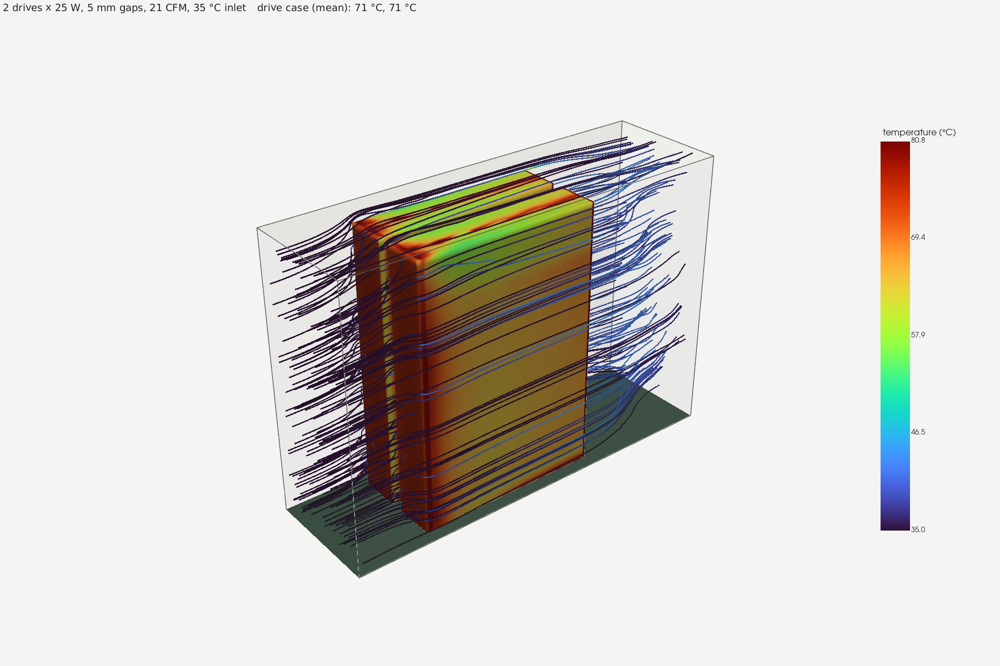
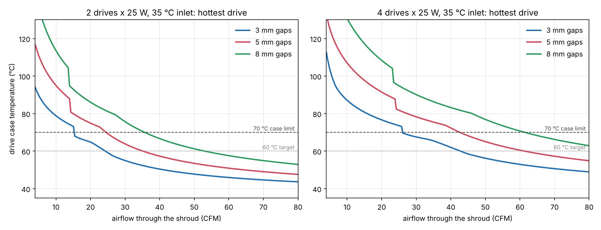

# U.3 PCIe adapters

Passive, PCIe 4.0 adapters for U.3 (SFF-TA-1001) NVMe drives, built around HPE P50230-B21 /
Samsung PM1735a drives that refuse U.2-wired hosts. KiCad projects, fabbed at JLCPCB or PCBWay.

## Designs

| Design | Boards | Status |
| --- | --- | --- |
| [**x16 / x8 U.3 cards**](designs/x16-u3-card/) | x8 card (2 drives), x16 card (4 drives, passive or with retimer), OCuLink cage board | cage board routed and DRC clean; cards in layout |
| [**Minisforum MS-01 / MS-A2**](designs/minisforum-u3/) | U.3-wired x4 card for the PCIe slot, U.3-wired replacement for the M.2 adapter | waiting on measurements of the stock adapters |
| [**4-drive U.3 backplane**](designs/u3-backplane/) | Modular backplane, 4 drives on 2x SlimSAS 8i, tiles side by side in a printed cage | planned (after the x8/x16 cards) |
| [**Cooling shroud**](docs/thermal/) | 3D-printed high-temp shroud for the Jonsbo N5 | sized from the thermal analysis; model in progress |

<table>
<tr>
<td> Cage board, top</td>
<td> Cage board, bottom (OCuLink)</td>
</tr>
<tr>
<td> CFD: 2 drives x 25 W in the shroud</td>
<td> Drive temperature vs airflow</td>
</tr>
</table>

## Cooling in one paragraph

Each drive can draw ~25 W. Standing upright on the card with 5 mm gaps, 2 drives need about
25 CFM through the shroud and 4 drives about 43 CFM to stay at 70 °C with 35 °C air coming in;
3 mm gaps cut that to 15 and 26 CFM if the fan has the pressure for it. A quiet 92 mm fan is not
enough; a 92x38 mm server-class fan keeps the drives around 60–66 °C. Details, assumptions and
the OpenFOAM check: [`docs/thermal/`](docs/thermal/).

## Layout

| Path | Contents |
| --- | --- |
| [`design-rules/`](design-rules/) | Shared PCIe 4.0 + JLCPCB/PCBWay rules: stackups, impedance, `.kicad_dru` DRC rules, KiCad starter templates, SI scripts |
| [`designs/x16-u3-card/`](designs/x16-u3-card/) | x16 / x8 slot cards for 2–4 U.3 drives, OCuLink cage board |
| [`designs/minisforum-u3/`](designs/minisforum-u3/) | U.3 adapters for Minisforum MS-01 / MS-A2 (PCIe x4 card, M.2-slot board) |
| [`tools/render/`](tools/render/) | Headless 3D renders of any `.kicad_pcb` (real copper/mask/silk, STEP parts, drives plugged in) |
| [`tools/thermal/`](tools/thermal/) | Analytical airflow/thermal model and OpenFOAM CFD case generator for the drive stack |
| [`docs/`](docs/) | Research notes, renders (`docs/img/`), thermal results (`docs/thermal/`) |

## Conventions

- One folder per design under `designs/`; one KiCad project per board inside it.
- Every board uses a template from `design-rules/templates/` and the custom rules in
  `design-rules/pcie4_jlc_pcbway.kicad_dru`. Change the rules there, not per board.
- Don't commit KiCad backups, `*.kicad_prl`, or fab output zips (see `.gitignore`);
  attach fab outputs to GitHub releases instead.
- Re-render a board after changing it (`tools/render/render.py`) so the README pictures match.
