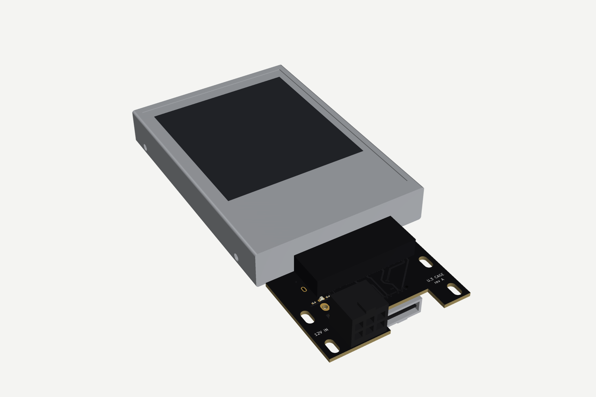
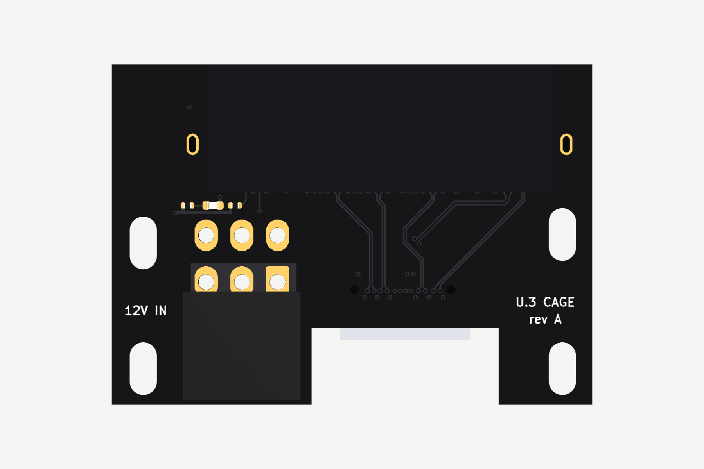
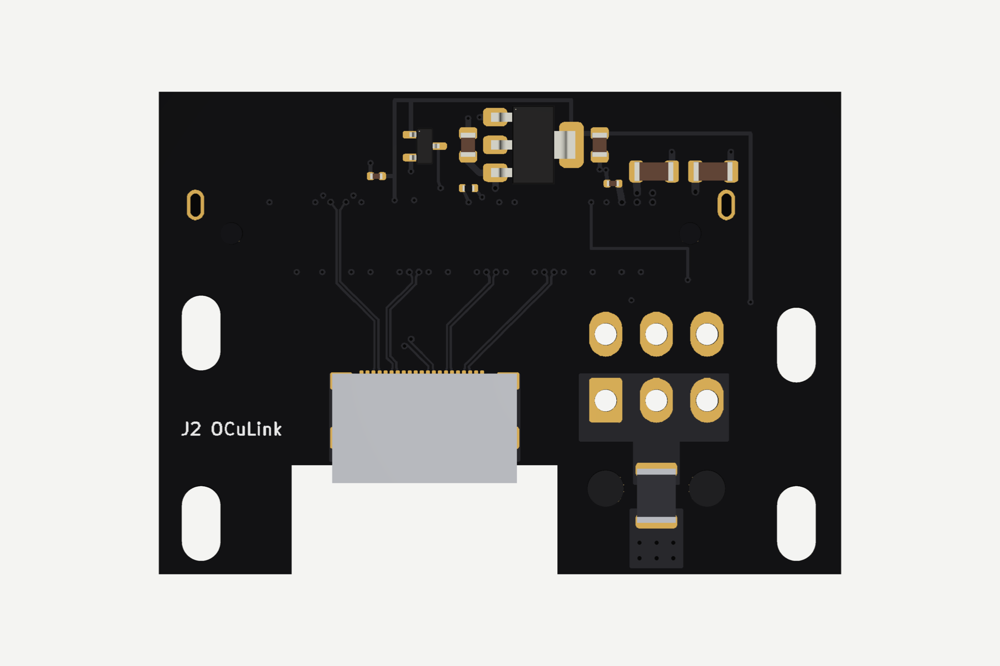
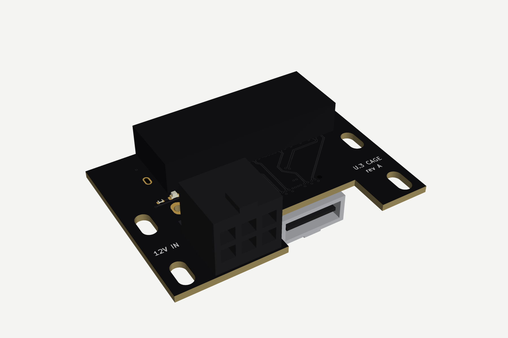
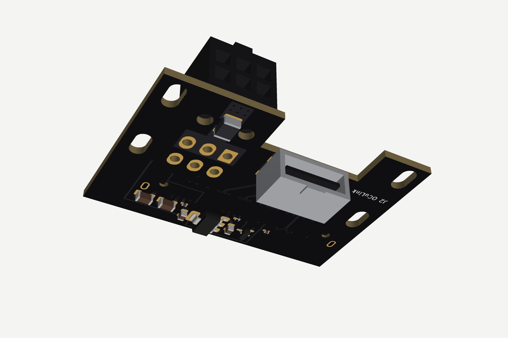
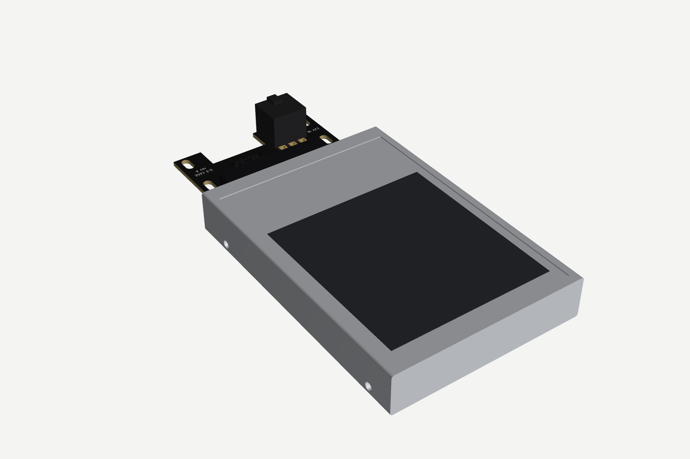

# U.3 adapter boards: x16 card, x8 card, OCuLink cage board

Passive PCIe 4.0 boards that carry true SFF-TA-1001 (U.3) wiring to 2.5" U.3 drives such as the
HPE P50230-B21 / Samsung PM1735a, which refuse U.2-wired hosts. Designed for a Jonsbo N5 build
with a 3D-printed cooling shroud.

## Boards

| Board | What it is | Status |
| --- | --- | --- |
| **x8 card** (`boards/x8/`) | x8 slot (x4x4 bifurcation), 2 drives standing upright on their connectors, connectors facing the motherboard, passive, REFCLK buffer, full sidebands, per-drive 12 V jumper and eFuse, 190 mm | rev F routed, DRC clean, all lanes ≤50 mm |
| **x16 card, passive, 4 drives** (`boards/x16p/`) | x16 slot (x4x4x4x4), 4 upright drives in a row on a 312 mm card; drives B–D sit 5.7 mm higher so lanes 8–15 pass under drive B | rev F; drive A in budget, B 45–54 mm, C ~110 mm, D ~170 mm: C/D run at PCIe Gen3 (silk says so), Gen4 on all four comes with the retimer card |
| **x16 card, passive, 3 drives** (`boards/x16p3/`) | same card with drives A–C only, 239 mm; host bifurcation x4x4x4 or x8x4x4, lanes 12–15 unused | rev F; drive C at PCIe Gen3 |
| **CDCDB400 clock versions** (`boards/*-cdcdb400/`) | the three cards above with a TI CDCDB400 instead of the PI6CB33401 / 9DBL0442 buffer | see [`docs/part-options.md`](../../docs/part-options.md) |
| **x16 card with retimer** | as above, with a retimer on lanes 8–15 so all 4 drives stay compliant | planned (part search) |
| **OCuLink cage board** (`boards/cage/`) | OCuLink 4i (SFF-8611) to U.3 breakout for a drive in a printed cage; 12 V in on a PCIe 6-pin | routed, DRC clean (design-rules Rev D); rev B only if cabled drives come back |

Renders are regenerated from the KiCad files whenever a board changes (see
[`tools/render`](../../tools/render/)); boards still in layout get their renders when they are DRC clean.

## OCuLink cage board

56.5 x 40 mm, 6 layers (JLC06161H-3313), PCIe lanes on L1/L6 only. The OCuLink receptacle sits on
the bottom in the edge notch, the U.3 receptacle on top mates the drive at the upper edge, and a
PCIe 6-pin (Molex Mini-Fit Jr) brings 12 V through a PTC fuse; an AMS1117 makes 3.3 V aux.
Four M3 slots (3.2 x 6.2 mm, along the insertion axis) hold it in the printed cage.

| Top | Bottom (seen from below) |
| --- | --- |
|  |  |
|  |  |

With a 15 mm U.3 drive plugged in:

| Front | Back |
| --- | --- |
|  |  |

Copper, mask and silkscreen in the renders come from the real layer geometry. The U.3 and
OCuLink receptacles, the Mini-Fit header and the drive are simplified appearance models.

Fab files: [`fab/cage/`](fab/cage/) (Gerbers, BOM, CPL for JLCPCB / PCBWay).

## x8 card

CEM x8 edge (bifurcate the slot x4x4). Both U.3 receptacles sit on the bottom, mirrored, so the drives stand
upright with their connectors facing the motherboard and lane order needs no crossings. The card is cut away
behind the drives for airflow. A 9DBL0442 buffer (bottom side, left of the fingers) fans REFCLK out to both drives.
AC caps (220 nF) sit on the drive-to-host lanes per SFF-TA-1001. 190 mm long. Sidebands and 12 V work as described
under [Sidebands and power](#sidebands-and-power). Fab files: [`fab/x8/`](fab/x8/).

## x16 card (passive)

Same construction as the x8, four drives in a row (A–D, 73 mm pitch, 312 mm = CEM full length). The 3-drive card
(`U3_DRIVES=3 python3 gen/x16.py`) is the same design cut after drive C (239 mm). Drive B's
lane pads sit right above fingers 8–15, and right of the fingers the card edge rises to 12.75 mm, so lanes 8–15
run in a 0.9 mm-pitch stack under drive B and drives B–D sit 5.7 mm higher than A to make room. Lane lengths
finger→receptacle: A 30–46 mm, B 45–54 mm, C 107–115 mm, D 164–172 mm (the DRU documents the over-budget nets).
Drives C and D are past the Gen4 loss budget, so they are meant to run at PCIe Gen3 (silk: "C/D: PCIe Gen3 only"); the
retimer card is the Gen4 option for all four.

REFCLK (rev C): the card's 9DBL0442 (same buffer and card-level parts as the x8) feeds drive A directly and starts a
chain on L6 in the channel under drive A's block. Left of drive B a second 9DBL0442 (U40) takes the chain, drives B and
passes the clock on to a third one left of drive C (U41), which drives C and D. On the 3-drive card U40 drives B and C.
So only one clock pair ever runs under a sideband block, every pair stays short between buffers, and each repeater
gets 3.3 V aux from an extra tap on the L3 trunk. The 6-pin aux connector (J5) sits at the card end below drive D's
(or C's) power parts, with its 22 µF bulk cap on the bottom next to the +12 V pins. Fab files: [`fab/x16p/`](fab/x16p/), [`fab/x16p3/`](fab/x16p3/).

## Rev E and rev F changes (x8 and x16 cards)

**Which side the drives are on.** On these cards the receptacles are soldered to the solder side (KiCad bottom), so
the drives hang behind the card, where a CEM card may only be 2.67 mm tall and where the neighbouring slot is. This
was chosen because the U.3 lane order then matches the finger order without crossings. A version with the drives and
all tall parts on the component side is under discussion; it needs a new card-level layout and PCIe lane reversal.

Rev E (from the 2026-11-13 review):

- REFCLK buffer is the Diodes PI6CB33401ZHIEX (pin-identical to the 9DBL0442, which is the BOM alternate). Pin 1 is
  open on every buffer that runs in bypass mode.
- 4-drive card: the last repeater (U41, feeding C and D) runs as a zero-delay buffer (pin 1 to GND, low-bandwidth
  PLL) with its own ferrite and 100 nF on VDDA, so no drive sees more than two buffer delays. **This is only valid
  while drives C and D run at Gen3**, which they do on the passive card.
- TPS2116: slot 3.3 V has priority, 3.3 V aux is the fallback.
- eFuse: ITIMER 4.7 nF (about 2 ms blanking), ILIM 390 Ω (3.85 A), IMON 1 kΩ (0.25 V/A).
- x16 cards: the window edge is 9.9 mm from the receptacle peg line (rev D: 9.4). 9.4 and 9.6 do not route on the
  4-drive card. The housing face is at 10.05 mm, so only 0.15 mm is left. **Fit a drive into a bare board before
  assembling anything** and file the edge back if the drive body touches it.

Rev F (all parts on the top side, 0603 or larger, or leaded):

| Feature | Where | Notes |
| --- | --- | --- |
| I2C header J6 (1x4, 2.54 mm) | bracket column | 3V3 aux, SCL, SDA, GND of the card-local bus (behind the TCA9548A) |
| EEPROM AT24C02 at 0x50 | bracket column | on the card-local bus, write-enabled |
| Test pads, 1 mm | per drive: 12 V after the eFuse, PG, IMON. Per card: 3V3 aux, 3V3, PERST#, 12 V, 12 V aux, fan tach, fan PWM | last drive's pads are labelled V, P, I |
| GND loops | bracket column and end column | for a scope ground |
| LEDs | per drive: 12 V present after the eFuse. Per card: 12 V, 12 V aux, 3V3 | the per-drive LED hangs on the drive's 12 V (2.2 k), not on PG |
| Fan header J7 (4-pin PWM) | far end of the strip | SJ4 = slot 12 V, SJ5 = aux 12 V, close exactly one. x8: slot is bridged from the fab (one via, about 1 A). x16: aux is bridged (1.0 mm on the top layer from J5, about 3 A). PWM and tach go to test pads only, so a 4-wire fan runs at full speed |
| TVS SMBJ15A | at J5 | on 12 V aux |
| M3 holes | H7–H10 in the two columns, H11 up in the strip between drives | the strip holes are searched after routing; a gap without a free spot gets none (x16: the gap between B and C on the 4-drive card) |
| Silk | bracket column | I2C address table and jumper legend |

## Sidebands and power

Every drive has its own sideband block next to its receptacle (`gen/sideband.py`), all on 3.3 V aux:

| Part | Address | Does |
| --- | --- | --- |
| TCA9543A SMBus switch | 0x70 + drive index | slot SMBus (B5/B6) to the drive's SMBus on channel 0, so drives with the same address don't collide |
| TCA9554 IO expander | 0x20 + drive index | P0 PWRDIS (10k pull-down: drive on by default), P1 DualPortEn#, P2 reset enable (pull-up), P3 locate LED, P4 PRSNT#, P5 IfDet#, P6 IfDet2#, P7 WAKE# (inputs pulled up) |
| 74LVC1G11 | | PERST0#/PERST1# = slot PERST# AND reset enable AND the drive's eFuse power-good: a drive stays in reset until its own 12 V is up, and software can hold one drive in reset |
| 74LVC1G07 | | drive WAKE# to slot WAKE# (B11), open drain, wired-OR across drives |

Card-level parts (rev C, `gen/cardkit.py`, left of the fingers):

| Part | Does |
| --- | --- |
| TCA9548A SMBus switch, 0x77 | slot SMBus to a card-local bus on channel 0, so the drive-side switches and expanders (0x70+, 0x20+) never sit on the host's segment. Close SJ1–SJ3 to move it to 0x70–0x76 if the host already uses 0x77 |
| TPS2116 power mux | card 3.3 V aux rail = slot 3.3 V (priority, rev E) or slot 3.3Vaux when main 3.3 V is off, so in S0 the card never loads 3.3Vaux |
| PI6CB33401 REFCLK buffer (9DBL0442 pinout) | slot REFCLK to every drive; its own 3.3 V through a ferrite |

HPT0 (S15) is tied to GND for U.3 x4. REFCLK1 and port B stay open (single-port x4). CLKREQ# (B12) is tied low, so
the host always drives REFCLK (as on cards without clock power management). WAKE# from every drive reaches the slot
through its 74LVC1G07 and can also be read on its expander. SMBus, 3.3 V aux, PERST# and WAKE# run as trunks on L3,
with one tap via per drive block.

**12 V:** each drive has a 3-pin jumper (JP1–JP4). Shunt on pins 2–3 (default) = slot 12 V, pins 1–2 = the PCIe
6-pin (J5). One shunt can never join the two supplies. L4 is split into a slot-12 V plane next to the fingers and an
aux-12 V plane fed only by J5. A slot gives at most 66 W at 12 V, so with more than two 25 W drives move some jumpers
to aux and plug in the 6-pin. Jumper shunts (2.54 mm) are not in the BOM. After the jumper each drive has a
TPS25982 eFuse (3.85 A circuit breaker with about 2 ms blanking, soft start, latch-off on a fault) feeding the drive's 12 V pins and bulk
caps; its power-good holds that drive's PERST#.

**Rules beyond the shared design rules (in each board's DRU):**
- Sideband blocks route at 0.127 mm tracks and 0.15 mm clearance (fab minimum 0.1 / 0.1).
- x16: REFCLK repeater links (REFCLK_R*, B, C, D) may have up to 12 mm uncoupled length (two via fans, two QFN pin
  fan-outs and the skew bumps for the turns); the other REFCLK pairs keep 8 mm.
- The eFuse's 0.5 mm-pitch QFN pins fan out at 0.2 mm on the 12 V nets inside the EFUSE rule areas; the pours carry the current.
- The slot REFCLK input may run up to 16 mm uncoupled (P/N swap at the buffer plus its deskew bumps). REFCLK is 100 MHz, so this costs no margin.
- The card's resistor array is RN10, so it does not clash with the drive blocks' RN1–RN4.

## Cooling

Two or four 25 W drives standing on the card need a ducted fan. Summary from
[`docs/thermal`](../../docs/thermal/): 2 drives need ~25 CFM through 5 mm gaps (35 °C air in,
70 °C case), 4 drives ~43 CFM; 3 mm gaps cut that to 15 and 26 CFM but need a high-pressure fan.
A quiet 92 mm fan is not enough; a 92x38 mm server-class fan holds the drives around 60–66 °C.

## Generator

All boards are generated by Python scripts on KiCad 7 `pcbnew`. To change a board, edit its script and rerun it; don't hand-edit the board.

- `lib/`: custom footprints (Amphenol PSAS4F213002 U.3 receptacle, Amphenol G14A421211112HR OCuLink 4i) and symbols
- `gen/pcbkit.py`: layout toolkit (pair router with skew bumps, zones, rule areas, DRC)
- `gen/x8.py`: x8 card (2 upright drives on the bottom, REFCLK fan-out buffer, drive window for airflow)
- `gen/x16.py`: x16 passive card (4 drives; `U3_DRIVES=3` for the 3-drive card)
- `gen/sideband.py`: per-drive sideband block (SMBus switch, IO expander, PERST# and WAKE# gates, 12 V jumper, eFuse)
- `gen/cardkit.py`: card-level parts shared by the x8 and x16 cards (REFCLK buffer, SMBus switch, 3.3 V aux OR, trunks)
- `gen/extras.py`: rev F additions (headers, test pads, LEDs, fan header, holes); runs after the block routing
- Switches: `U3_DRIVES=3|4`, `U3_CLK=cdcdb400` (alternate clock buffer, own `boards/*-cdcdb400` folder), `STAGE=card` (quick build without block routing)
- `gen/router.py`: grid maze router for the low-speed sideband nets, with rip-up and reroute and a connectivity check at the end
- `gen/cage.py`: Design 3, the OCuLink 4i to U.3 cage board (status: routed, DRC clean on design-rules Rev D)
- `gen/fab.py`: Gerbers, drill, BOM and CPL (JLCPCB/PCBWay)
- `boards/<board>/`: generated KiCad project, DRC report, per-net lengths
- `fab/<board>/`: Gerber zip, BOM and CPL for ordering
- `docs/ref/`: vendor drawings and third-party licences

Rules come from `../../design-rules/` (copied into each board at generation time).

Run: `python3 gen/fplib.py && python3 gen/symlib.py && python3 gen/cage.py && python3 gen/fab.py boards/cage/u3_cage.kicad_pcb boards/cage/bom_raw.json fab/cage`

Render: `xvfb-run -a python3 ../../tools/render/render.py boards/cage/u3_cage.kicad_pcb ../../docs/img/x16-u3-card --prefix cage --drives`
