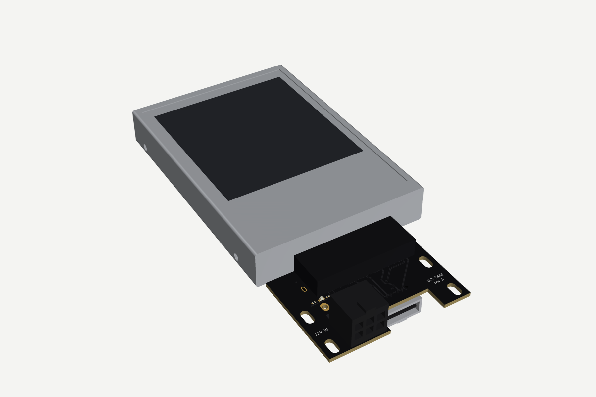
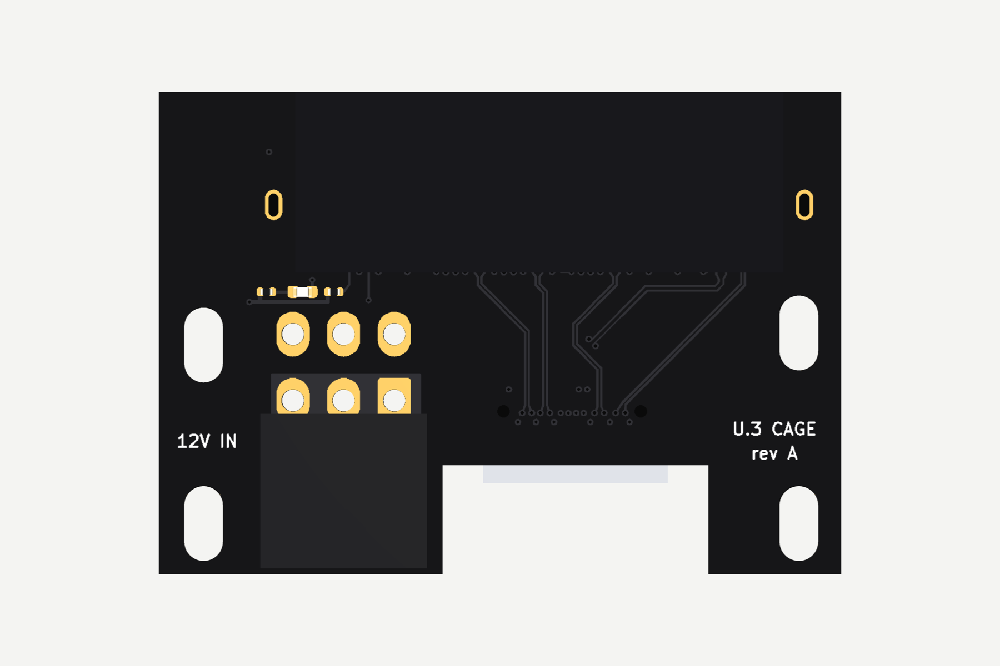
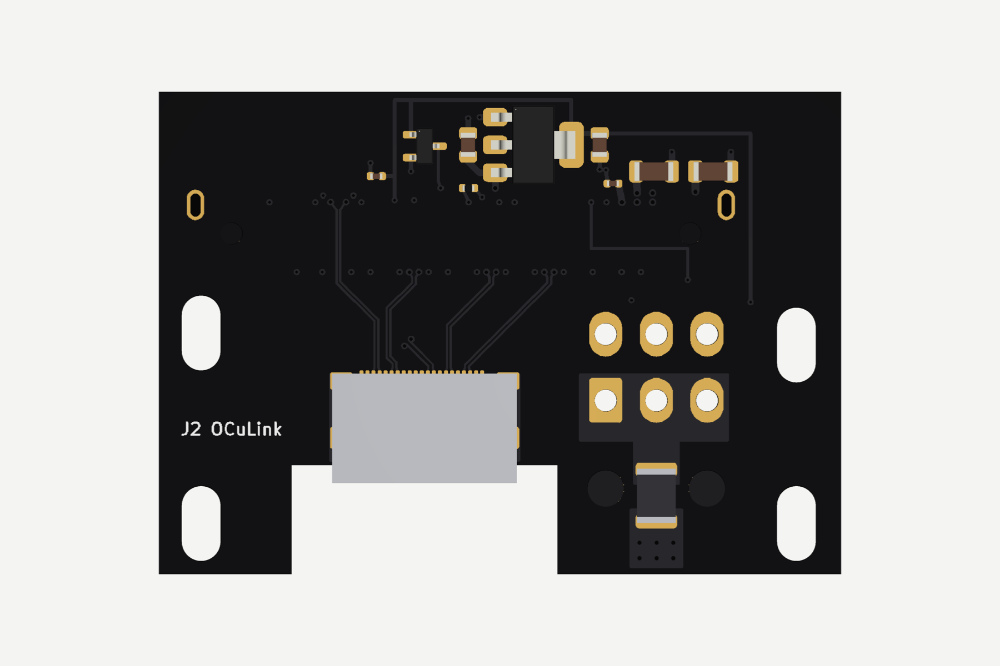
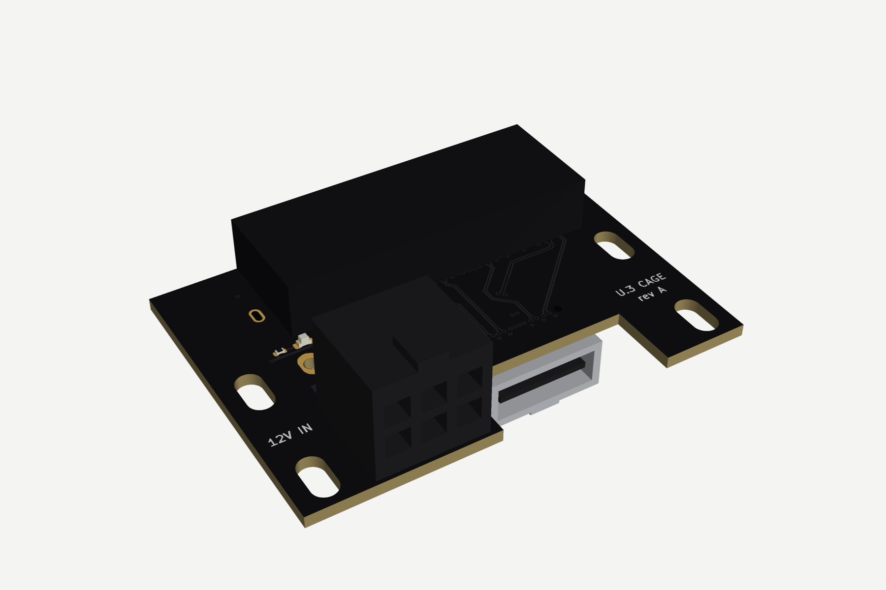
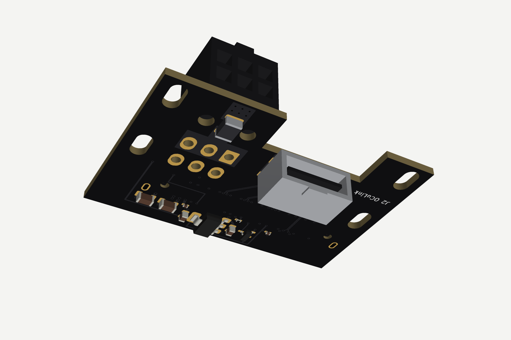
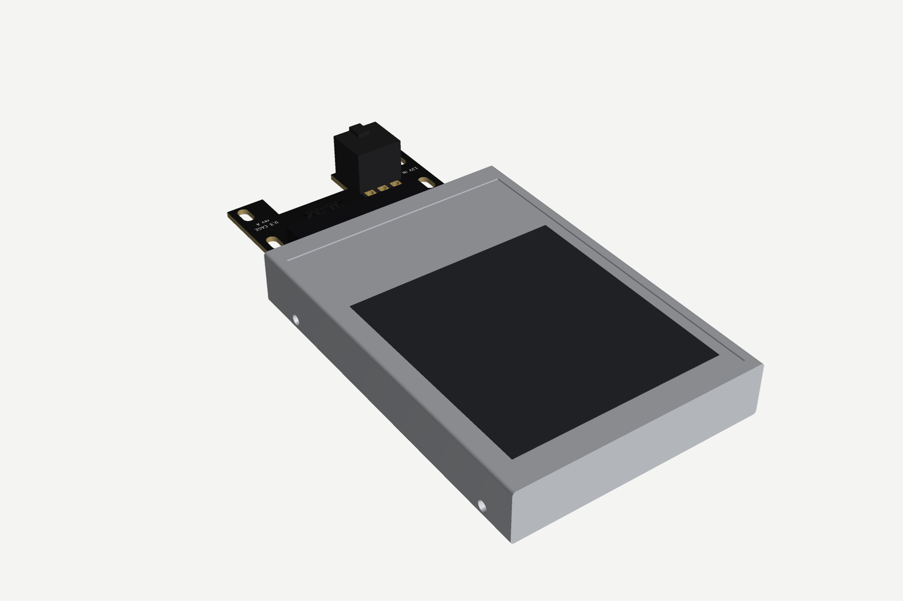

# U.3 adapter boards: x16 card, x8 card, OCuLink cage board

Passive PCIe 4.0 boards that carry true SFF-TA-1001 (U.3) wiring to 2.5" U.3 drives such as the
HPE P50230-B21 / Samsung PM1735a, which refuse U.2-wired hosts. Designed for a Jonsbo N5 build
with a 3D-printed cooling shroud.



## Boards

| Board | What it is | Status |
| --- | --- | --- |
| **x8 card** (`boards/x8/`) | x8 slot (x4x4 bifurcation), 2 drives on the card front (CEM component side), passive, REFCLK buffer, full sidebands, per-drive 12 V jumper and eFuse, 191.7 mm with the tail tab for the 6-pin | rev G routed, DRC clean; drive A 28–38 mm, drive B 45–66 mm (three lanes over the 50 mm rule); relies on PCIe lane reversal |
| **x16 card, passive, 4 drives** (`boards/x16p/`) | x16 slot (x4x4x4x4), 4 drives in a row on the card front, 334.7 mm with the tail tab (longer than a full-length CEM card); drives A–C sit 5.7 mm higher than D so lanes 8–15 pass under them | rev G; A 37–46 mm, B 43–69 mm, C ~107–126 mm, D ~158–178 mm: C/D run at PCIe Gen3 (silk says so); relies on lane reversal |
| **x16 card, passive, 3 drives** (`boards/x16p3/`) | same card with drives A–C only, 261.7 mm; host bifurcation x4x4x4 or x8x4x4, lanes 12–15 unused | rev G routed, DRC clean; A 37–46 mm, B 44–69 mm, C 101–121 mm (Gen3) |
| **CDCDB400 clock versions** (`boards/*-cdcdb400/`) | cards with a TI CDCDB400 instead of the PI6CB33401 / 9DBL0442 buffer | x8: rev G. x16: **still rev F (drives on the back)**, not laid out for the front cards yet; see [`docs/part-options.md`](../../docs/part-options.md) |
| **x16 card with retimer** | as above, with a retimer on lanes 8–15 so all 4 drives stay compliant | planned (part search) |
| **OCuLink cage board** (`boards/cage/`) | OCuLink 4i (SFF-8611) to U.3 breakout for a drive in a printed cage; 12 V in on a PCIe 6-pin | rev B routed, DRC clean (review fixes applied; the cabled path still needs a host-card retimer for full compliance) |

Renders are regenerated from the KiCad files whenever a board changes (see
[`tools/render`](../../tools/render/)); boards still in layout get their renders when they are DRC clean.

## OCuLink cage board

Rev B. 56.5 x 37.65 mm, 6 layers (JLC06161H-3313), PCIe lanes on L1/L6 only. The OCuLink receptacle sits on the
bottom in the edge notch, the U.3 receptacle on top mates the drive at the upper edge, and a PCIe 6-pin
(Molex Mini-Fit Jr) brings 12 V through a 3 A PTC fuse; a SOT-89 LDO (MCP1703AT-3302E/MB, pinout checked
against the Microchip datasheet; the HT7533-1 is an LCSC alternative only after its pinout is checked) makes 3.3 V aux. Four M3 slots (3.2 x 6.2 mm, along the insertion axis) hold it in
the printed cage.

Rev B changes (from the rev A review, `docs/reviews/cage-board-review.md`, and `docs/reviews/full-review-2026-11-13.md`):

- 220 nF AC caps on PER0/PER1 (bottom side, L5 voided under the pads). A U.3 drive has no TX caps on lanes 0/1
  (SFF-TA-1001 Rev 1.1 section 4.5), so rev A left those two lanes DC-coupled.
- The drive-side board edge now ends 9.4 mm from the peg line, 0.65 mm short of the housing face, so the board can
  no longer stop the drive before it is fully seated. The receptacle overhangs the edge by design.
- 100 k pull-down on PERST#: a missing or sideband-less cable holds the drive in reset.
- The four low-speed OCuLink vias moved off the PET via row into two rows in front of it, and a return via was
  added between the PET3 and PET2 transitions. The 11 mm slot in the L2/L5 planes is now two short ones with a
  2.7 mm bridge.
- Parts: F1 mSMD300-16V (3 A hold, C6851473), LED KT-0603YG (C2289), C3 50 V (C307331), LDO as above (the AMS1117
  was at its 15 V limit, needs a minimum load and is not stable with ceramic output caps).

The renders below still show rev A.

Still open on this board: the cabled path needs a retimer on the host card for full PCIe 4.0 compliance
(design-rules Rev E), PERST#/REFCLK/SMBus are not isolated when the cage is unpowered, and the PET0 lane is 30.4 mm
(0.4 mm over the per-board target).

| Top | Bottom (seen from below) |
| --- | --- |
|  |  |
|  |  |

With a 15 mm U.3 drive plugged in:

| Front | Back |
| --- | --- |
|  |  |

Copper, mask and silkscreen in the renders come from the real layer geometry. The U.3 and
OCuLink receptacles, the Mini-Fit header and the drive are simplified appearance models.

Fab files: [`fab/cage/`](fab/cage/) (Gerbers, BOM, CPL for JLCPCB / PCBWay).

## Rev G: drives on the card front

From rev G on the U.3 receptacles, the aux power plug, the fan header, the 12 V jumpers and every other tall part
sit on the card front (the CEM component side, where a card may be 14.47 mm tall and more with a free neighbour
slot). The back carries only flat SMD parts. Rev F and earlier had the drives on the back, where a CEM card may
only be 2.67 mm tall; those boards are in the git history (merge of PR #17).

**Lane order.** Seen from the front, a receptacle's lane order runs against the finger order. The cards wire every
lane straight through, so finger lane n lands on drive lane 3 - n mod 4, and every x4 port has to train
lane-reversed. Lane reversal is optional in PCIe; most root ports and NVMe controllers do it, but it could not be
confirmed from any document for the EPYC 7002/7003 + Supermicro H12SSL + Samsung PM1735 combination this was
built for. **If neither end reverses, the drive does not link at all.** Check this with one drive before
populating the rest:

```
lspci -vv -s <drive's bus address> | grep -E "LnkCap|LnkSta"
# expected: LnkSta: Speed 16GT/s, Width x4   (drives C/D on the x16 cards: 8GT/s is by design)
```

A link at x1 or x2, or no device at all, means the port did not reverse. The rev F cards (drives on the back) are
the wiring that needs no reversal. Uncrossing the lanes on a front card is possible only by looping every lane
bundle around its receptacle (two signal layers, no room to cross): about 35 mm more per drive, which takes even
drive A out of the 50 mm budget. It is not built.

**How the cards are generated.** `gen/x8.py` and `gen/x16.py` build the card in a mirrored frame (drives on the
bottom, as before) and flip the whole board once when saving (`Kit.mirror_all`). Layer names in the generator are
mirrored too (L1 there is the physical L6, L3 the physical L4).

## x8 card

CEM x8 edge (bifurcate the slot x4x4). Two drives on the card front, the card is cut away behind them for airflow.
Drive A is next to the bracket (lanes 0–3, 28–38 mm), drive B at the free end (lanes 4–7, 45–66 mm; PET6, PET7 and
PER7 are over the 50 mm rule and have their own DRU rule, so expect drive B to be the first to drop to Gen3 on a
marginal host). The REFCLK buffer sits at the free end; the slot clock runs there on L4 under the lane field
(106 mm), drive A's pair comes back on the front layer under drive B. The PCIe 6-pin (J5), its bulk cap and TVS sit
on a 22.6 mm tail tab, plug toward the card end. The fan header is at the bracket end. AC caps (220 nF) sit on the
drive-to-host lanes per SFF-TA-1001. Sidebands and 12 V work as described under
[Sidebands and power](#sidebands-and-power). Fab files: [`fab/x8/`](fab/x8/).

## x16 card (passive)

Same construction with four drives in a row (D C B A from the free end, A at the bracket, 73 mm pitch). The 3-drive
card (`U3_DRIVES=3 python3 gen/x16.py`) is the same design without drive D. The drive at the free end sits on the
low peg line, the others 5.7 mm higher, so the lanes to the far drives pass between the fingers and the nearer
receptacles in a 0.9 mm-pitch stack. Lane lengths finger to receptacle: A 37–46 mm, B 43–69 mm, C 101–126 mm,
D 158–178 mm (the DRU documents the over-budget nets). C and D are past the Gen4 loss budget and are meant to run at
PCIe Gen3 (silk: "C/D: PCIe Gen3 only"). With the tail tab for the 6-pin the 4-drive card is 334.7 mm long, 22.6 mm
more than a full-length CEM card; the 3-drive card is 261.7 mm. **Check the case before ordering the 4-drive card.**

REFCLK (rev G): one buffer at the bracket end, next to the fingers, feeds every drive through its own pair, so
every drive sits behind exactly one buffer stage (rev F chained up to three buffers, which only worked while C/D
ran at Gen3). The slot clock reaches the buffer on L4 (59 mm). Each output drops to L4 at the buffer, runs along
the channel between the fingers and the receptacles as a 0.11/0.25 mm stripline pair between the 12 V plane and the
GND plane, and comes up at the west end of its receptacle. Pair lengths: A 81 mm, B 144 mm, C 215 mm, D 277 mm
(3-drive card: 84, 147, 204 mm). At 100 MHz that is well under 1 dB of loss on the longest pair, and 3 ns of buffer
delay plus 2 ns of flight time stay inside the 12 ns common-clock budget. The slot's SMBus, PERST#, WAKE# and
3.3 V lines run in the same channel on L4 to the TCA9548A / TPS2116 cluster at the free end.

The fan header (J7) sits on the tail tab next to the 6-pin and is fed from the aux 12 V plug only: the slot cannot
spare a 92x38 fan's 3 A next to three or four drives. Without the 6-pin plugged in, run the fan from a motherboard
header. Fab files: [`fab/x16p/`](fab/x16p/), [`fab/x16p3/`](fab/x16p3/).

## Rev E and rev F changes (x8 and x16 cards)

These revisions had the drives on the back of the card; rev G (above) moved them to the front. The electrical
changes below still apply, except where the rev G sections say otherwise (x16 clock, fan header, jumper type).

Rev E (from the 2026-11-13 review):

- REFCLK buffer is the Diodes PI6CB33401ZHIEX (pin-identical to the 9DBL0442, which is the BOM alternate). Pin 1 is
  open on every buffer that runs in bypass mode.
- 4-drive card: the last repeater (U41, feeding C and D) runs as a zero-delay buffer (pin 1 to GND, low-bandwidth
  PLL) with its own ferrite and 100 nF on VDDA, so no drive sees more than two buffer delays. **This is only valid
  while drives C and D run at Gen3**, which they do on the passive card.
- TPS2116: slot 3.3 V has priority, 3.3 V aux is the fallback.
- eFuse: ITIMER 4.7 nF (about 2 ms blanking), ILIM 390 Ω (3.85 A), IMON 1 kΩ (0.25 V/A).
- x16 cards: the window edge is 9.9 mm from the receptacle peg line (rev D: 9.4). 9.4 and 9.6 do not route on the
  4-drive card. The housing face is at 10.05 mm, so only 0.15 mm is left. **Fit a drive into a bare board before
  assembling anything** and file the edge back if the drive body touches it.
  When ordering, add the note "window edges +0/-0.2 mm toward the drive": the fab's outline tolerance (about
  0.2 mm) is larger than the 0.15 mm that is left.

Rev F (all parts on the top side, 0603 or larger, or leaded):

| Feature | Where | Notes |
| --- | --- | --- |
| I2C header J6 (1x4, 2.54 mm) | bracket column | 3V3 aux, SCL, SDA, GND of the card-local bus (behind the TCA9548A) |
| EEPROM AT24C02 at 0x50 | bracket column | on the card-local bus, write-enabled |
| Test pads, 1 mm | per drive: 12 V after the eFuse, PG, IMON. Per card: 3V3 aux, 3V3, PERST#, 12 V, 12 V aux, fan tach, fan PWM | last drive's pads are labelled V, P, I |
| GND loops | bracket column and end column | for a scope ground |
| LEDs | per drive: 12 V present after the eFuse. Per card: 12 V, 12 V aux, 3V3 | the per-drive LED hangs on the drive's 12 V (2.2 k), not on PG |
| Fan header J7 (4-pin PWM) | far end of the strip | SJ4 = slot 12 V, SJ5 = aux 12 V, close exactly one. x8: slot is bridged from the fab (one via, about 1 A). x16: aux is bridged (1.0 mm on the top layer from J5, about 3 A). PWM and tach go to test pads only, so a 4-wire fan runs at full speed. **A fan above about 1 A (any 92x38 server fan) must run from aux: cut SJ4 and close SJ5 on the x8**, it does not fit the 66 W slot budget next to the drives either |
| TVS SMBJ15A | at J5 | on 12 V aux |
| M3 holes | H7–H10 in the two columns, H11 up in the strip between drives | the strip holes are searched after routing; a gap without a free spot gets none. **Rev G: no gap gets one**, the strip is full of lanes and clock pairs on the front cards |
| Silk | bracket column | I2C address table and jumper legend |

## Sidebands and power

Every drive has its own sideband block next to its receptacle (`gen/sideband.py`), all on 3.3 V aux:

| Part | Address | Does |
| --- | --- | --- |
| TCA9543A SMBus switch | 0x70 + drive index | slot SMBus (B5/B6) to the drive's SMBus on channel 0, so drives with the same address don't collide |
| TCA9554 IO expander | 0x20 + drive index | P0 PWRDIS (10k pull-down: drive on by default), P1 DualPortEn#, P2 reset enable (pull-up), P3 locate LED, P4 PRSNT#, P5 IfDet#, P6 IfDet2#, P7 WAKE# (inputs pulled up) |
| 74LVC1G11 | | PERST0#/PERST1# = slot PERST# AND reset enable AND the drive's eFuse power-good: a drive stays in reset until its own 12 V is up, and software can hold one drive in reset |
| 74LVC1G07 | | drive WAKE# to slot WAKE# (B11), open drain, wired-OR across drives |

Card-level parts (rev C, `gen/cardkit.py`, left of the fingers):

| Part | Does |
| --- | --- |
| TCA9548A SMBus switch, 0x77 | slot SMBus to a card-local bus on channel 0, so the drive-side switches and expanders (0x70+, 0x20+) never sit on the host's segment. Close SJ1–SJ3 to move it to 0x70–0x76 if the host already uses 0x77 |
| TPS2116 power mux | card 3.3 V aux rail = slot 3.3 V (priority, rev E) or slot 3.3Vaux when main 3.3 V is off, so in S0 the card never loads 3.3Vaux |
| PI6CB33401 REFCLK buffer (9DBL0442 pinout) | slot REFCLK to every drive; its own 3.3 V through a ferrite |

HPT0 (S15) is tied to GND for U.3 x4. REFCLK1 and port B stay open (single-port x4). CLKREQ# (B12) is tied low, so
the host always drives REFCLK (as on cards without clock power management). WAKE# from every drive reaches the slot
through its 74LVC1G07 and can also be read on its expander. SMBus, 3.3 V aux, PERST# and WAKE# run as trunks on L3,
with one tap via per drive block.

**12 V:** each drive has a 3-pin jumper (JP1–JP4), since rev G a through-hole header on the drive side in the gap
next to the receptacle (silk AUX / SLOT at its ends). It is a generic 1x3 2.54 mm header without an LCSC number in
the BOM: solder it by hand, see `fab/*/…-loose-parts.csv`. Shunt on pins 2–3 (default) = slot 12 V, pins 1–2 = the PCIe
6-pin (J5). One shunt can never join the two supplies. L4 is split into a slot-12 V plane next to the fingers and an
aux-12 V plane fed only by J5. A slot gives at most 66 W at 12 V, so with more than two 25 W drives move some jumpers
to aux and plug in the 6-pin. Jumper shunts (2.54 mm) are not in the BOM. After the jumper each drive has a
TPS25982 eFuse (3.85 A circuit breaker with about 2 ms blanking, soft start, latch-off on a fault) feeding the drive's 12 V pins and bulk
caps; its power-good holds that drive's PERST#.

**Rules beyond the shared design rules (in each board's DRU):**
- Sideband blocks route at 0.127 mm tracks and 0.15 mm clearance (fab minimum 0.1 / 0.1).
- x16 (rev G): every REFCLK pair runs on L4 between its two via pairs (0.11 / 0.25 mm) and may have up to 16 mm
  uncoupled length (two via fans, the QFN pin fan-out and the skew bumps of an 80–280 mm pair).
- x8 and x16 (rev G): drive lane 0 TX hops over the receptacle's top pad row (two via pairs), 3 mm uncoupled there.
- The eFuse's 0.5 mm-pitch QFN pins fan out at 0.2 mm on the 12 V nets inside the EFUSE rule areas; the pours carry the current.
- The slot REFCLK input may run up to 16 mm uncoupled (P/N swap at the buffer plus its deskew bumps). REFCLK is 100 MHz, so this costs no margin.
- The card's resistor array is RN10, so it does not clash with the drive blocks' RN1–RN4.

## Cooling

Two or four 25 W drives standing on the card need a ducted fan. Summary from
[`docs/thermal`](../../docs/thermal/): 2 drives need ~25 CFM through 5 mm gaps (35 °C air in,
70 °C case), 4 drives ~43 CFM; 3 mm gaps cut that to 15 and 26 CFM but need a high-pressure fan.
A quiet 92 mm fan is not enough; a 92x38 mm server-class fan holds the drives around 60–66 °C.

## Generator

All boards are generated by Python scripts on KiCad 7 `pcbnew`. To change a board, edit its script and rerun it; don't hand-edit the board.

- `lib/`: custom footprints (Amphenol PSAS4F213002 U.3 receptacle, Amphenol G14A421211112HR OCuLink 4i) and symbols
- `gen/pcbkit.py`: layout toolkit (pair router with skew bumps, zones, rule areas, DRC)
- `gen/x8.py`: x8 card (2 upright drives on the bottom, REFCLK fan-out buffer, drive window for airflow)
- `gen/x16.py`: x16 passive card (4 drives; `U3_DRIVES=3` for the 3-drive card)
- `gen/sideband.py`: per-drive sideband block (SMBus switch, IO expander, PERST# and WAKE# gates, 12 V jumper, eFuse)
- `gen/cardkit.py`: card-level parts shared by the x8 and x16 cards (REFCLK buffer, SMBus switch, 3.3 V aux OR, trunks)
- `gen/extras.py`: rev F additions (headers, test pads, LEDs, fan header, holes); runs after the block routing
- Switches: `U3_DRIVES=3|4`, `U3_CLK=cdcdb400` (alternate clock buffer, own `boards/*-cdcdb400` folder; x8 only since rev G), `STAGE=card` (quick build without block routing)
- `gen/router.py`: grid maze router for the low-speed sideband nets, with rip-up and reroute and a connectivity check at the end
- `gen/cage.py`: Design 3, the OCuLink 4i to U.3 cage board (rev B, DRC clean)
- `gen/fab.py`: Gerbers, drill, BOM and CPL (JLCPCB/PCBWay)
- `boards/<board>/`: generated KiCad project, DRC report, per-net lengths
- `fab/<board>/`: Gerber zip, BOM and CPL for ordering
- `docs/ref/`: vendor drawings and third-party licences

Rules come from `../../design-rules/` (copied into each board at generation time).

Run: `python3 gen/fplib.py && python3 gen/symlib.py && python3 gen/cage.py && python3 gen/fab.py boards/cage/u3_cage.kicad_pcb boards/cage/bom_raw.json fab/cage`

Render: `xvfb-run -a python3 ../../tools/render/render.py boards/cage/u3_cage.kicad_pcb ../../docs/img/x16-u3-card --prefix cage --drives`
