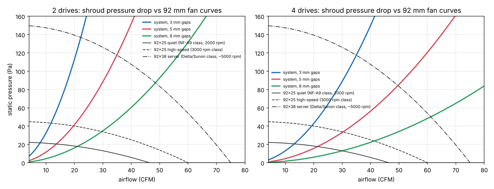
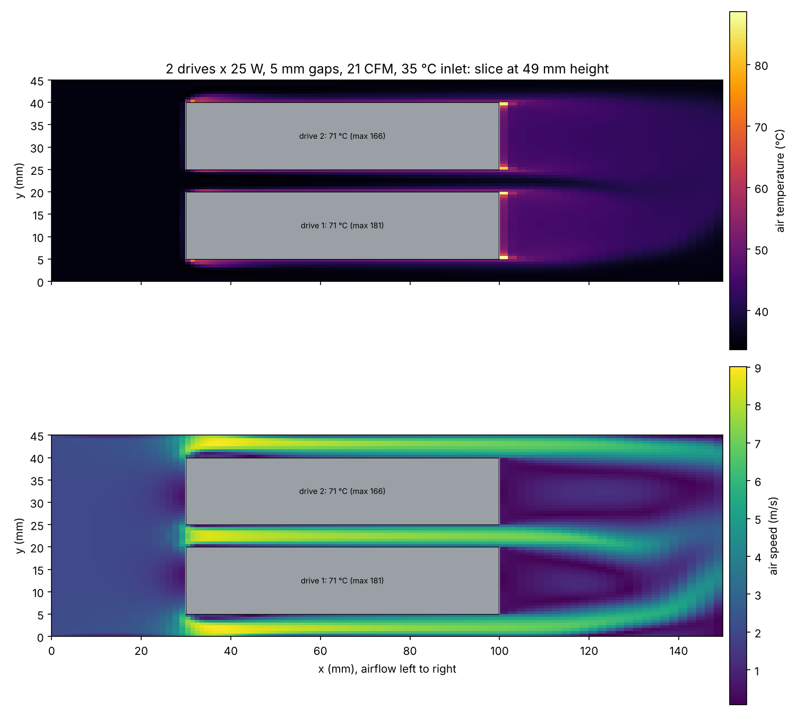

# Thermal analysis: U.3 drives under the cooling shroud

How much air do 2 or 4 PM1735a-class U.3 drives at ~25 W each need when they stand upright on
the adapter card inside a 3D-printed shroud, and which 92 mm fan delivers it?


## Short answer

- **2 drives x 25 W need about 25 CFM through the shroud with 5 mm gaps** to keep the drive cases
  at 70 °C with 35 °C air coming in, and about 35 CFM to hold 60 °C.
  With 3 mm gaps the same targets need 15 and 24 CFM.
- **4 drives x 25 W need about 43 CFM (5 mm gaps) or 26 CFM (3 mm gaps)** for 70 °C.
- A quiet 92x25 mm fan (NF-A9 class, ~22 Pa) cannot push that through the stack: the drives end
  up at 82–90 °C. A 92x38 mm server fan (~150 Pa static) holds them at about 60–66 °C.
- Narrow gaps (3–4 mm) with a high-pressure fan are the best combination, because the heat
  transfer coefficient in a narrow channel goes up faster than the airflow goes down.
  Block the bypass over the drive tops and keep the shroud walls tight to the outer drives.
- OpenFOAM agrees with the analytical model to within ~4 °C at the baseline point
  (CFD 71 °C, analytical 74 °C for 2 drives, 5 mm gaps, 21 CFM).

The 25 W figure is the coordinator's worst-case budget. Real mixed workloads on a 3.2 TB
PM1735a draw less; at 15–20 W per drive the airflow needed drops a lot (see sensitivity below).

## Geometry and assumptions

| Item | Value |
| --- | --- |
| Drive | 2.5" U.3, 100 (H) x 69.85 (along the airflow) x 15 mm, aluminium case treated as isothermal |
| Layout | drives stand upright on their connectors on the card, side by side with their 100 x 69.85 mm faces parallel, `gap` between faces and to the shroud walls |
| Air path | one 92 mm fan, shroud funnels it along the card length (along the 69.85 mm drive dimension); 5 mm bypass gap over the drive tops |
| Heat | 25 W per drive, all leaving by convection (conduction into the card and connector is ignored, which is conservative) |
| Inlet air | 35 °C (warm case interior in a Jonsbo N5 under load) |
| Limits | 70 °C drive case (typical enterprise SSD operating limit), 60 °C target for margin |
| Air | ρ 1.12 kg/m³, cp 1007 J/kgK, k 0.0275 W/mK, ν 1.7e-5 m²/s (~40 °C) |
| Fans | parabolic fits through datasheet free-air flow and max static pressure: 92x25 quiet 46 CFM / 22 Pa; 92x25 3000 rpm 60 CFM / 45 Pa; 92x38 server 75 CFM / 150 Pa. Class approximations, not a specific model. |

## Analytical model ([`tools/thermal/analytic.py`](../../tools/thermal/analytic.py))

Parallel-plate channels (Dh = 2 x gap). Laminar: Stephan's simultaneously developing mean Nusselt
number; outer channels heated on one side only are scaled by 5.385/7.541. Turbulent: Gnielinski
with an entrance correction, blended over Re 2300–4000. Each drive takes the air of the channels
next to it, and its temperature follows from an effectiveness-NTU balance for an isothermal wall.
Pressure drop: Shah's apparent friction for developing flow plus entry, exit and funnel losses.




Hottest drive at each fan's operating point (35 °C inlet, 25 W per drive):

| drives | gap | CFM for 70 °C | CFM for 60 °C | 92x25 quiet (NF-A9 class, 2000 rpm) | 92x25 high-speed (3000 rpm class) | 92x38 server (Delta/Sunon class, ~5000 rpm) |
| --- | --- | --- | --- | --- | --- | --- |
| 2 | 3 mm | 15.1 | 24.3 | 82 °C @ 8 CFM | 77 °C @ 12 CFM | 62 °C @ 22 CFM |
| 2 | 5 mm | 24.5 | 35.2 | 88 °C @ 14 CFM | 75 °C @ 20 CFM | 60 °C @ 35 CFM |
| 2 | 8 mm | 35.7 | 53.0 | 85 °C @ 21 CFM | 76 °C @ 30 CFM | 62 °C @ 48 CFM |
| 4 | 3 mm | 25.9 | 42.8 | 83 °C @ 13 CFM | 77 °C @ 19 CFM | 66 °C @ 35 CFM |
| 4 | 5 mm | 42.6 | 61.3 | 90 °C @ 21 CFM | 78 °C @ 30 CFM | 65 °C @ 50 CFM |
| 4 | 8 mm | 61.4 | 91.2 | 90 °C @ 30 CFM | 82 °C @ 41 CFM | 70 °C @ 61 CFM |

Sensitivity (5 mm gaps, airflow for a 70 °C case):

| Power per drive | 2 drives | 4 drives |
| --- | --- | --- |
| 15 W | 11 CFM | 18 CFM |
| 20 W | 16 CFM | 29 CFM |
| 25 W | 25 CFM | 43 CFM |

| Inlet air | 2 drives | 4 drives |
| --- | --- | --- |
| 25 °C | 15 CFM | 27 CFM |
| 30 °C | 20 CFM | 36 CFM |
| 35 °C | 25 CFM | 43 CFM |
| 40 °C | 29 CFM | 50 CFM |

## CFD ([`tools/thermal/foamcase.py`](../../tools/thermal/foamcase.py))

OpenFOAM v1912, `buoyantSimpleFoam` (steady, compressible, energy equation), k-ω SST turbulence,
gravity off. The domain is the shroud interior: 30 mm inlet plenum, the drive stack, 50 mm
outlet. The drives are cut out of a structured hex mesh (0.625 mm cells across the gaps for the
baseline, 0.83 mm for the sweep) and carry a uniform heat flux of 25 W over their wetted area.
The fan is a uniform-velocity inlet; the shroud and card are adiabatic walls.

The **area-mean drive wall temperature** is the number to compare with the 70 °C limit: the
real aluminium case spreads heat, so its temperature is close to that mean. The uniform-flux
boundary also produces hot spots in stagnant corners (the trailing end and the card corner),
reported as "hot spot". They are an artefact of that boundary condition and an upper bound,
not a prediction.

Baseline (2 drives, 5 mm gaps, 21 CFM, fine mesh): drive case 71 °C (both drives), pressure drop 26 Pa, air out 38 °C.
The full sweep table (2 and 4 drives, several airflows) is being added.



## Re-running

```sh
python3 tools/thermal/analytic.py docs/thermal                         # seconds
python3 tools/thermal/foamcase.py /tmp/case --drives 4 --gap 3 --cfm 30 --run   # ~10-30 min on 4 cores
python3 tools/thermal/sweep.py /tmp/sweep && python3 tools/thermal/plot_cfd.py /tmp/sweep docs/thermal
xvfb-run -a python3 tools/thermal/render_cfd.py /tmp/case docs/thermal/cfd_3d_<name>.png
```

Ubuntu 24.04: `apt install openfoam` (v1912). That build aborts when any function object is
loaded, so the scripts parse the written fields instead of using function objects.

## Limits of this analysis

- Fan curves are class approximations. Replace them with the chosen fan's datasheet curve.
- The shroud geometry is idealised (straight duct, uniform inlet). The real funnel from a 92 mm
  fan to the stack adds loss and non-uniform flow; the analytic model adds 0.3 dynamic heads for it.
- Heat leaving through the connector into the card and the case of the drive itself is ignored
  (conservative by a few °C).
- The drive's internal temperature (controller, NAND) runs above the case. The drive reports its
  composite temperature over NVMe (`nvme smart-log`); check it under load once built.
