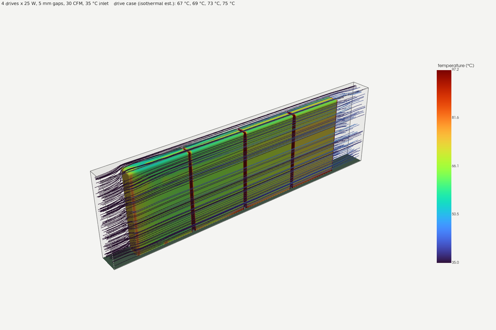
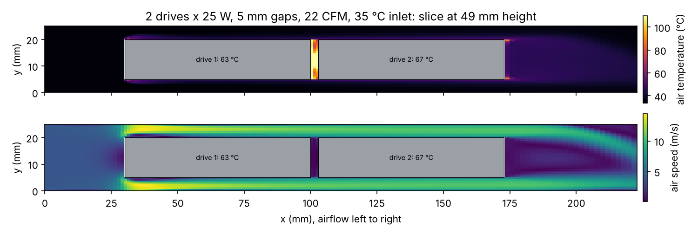
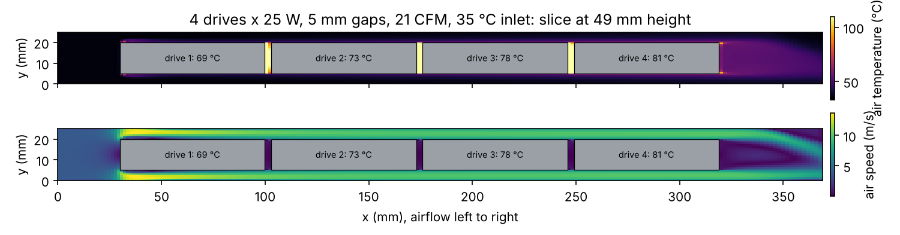
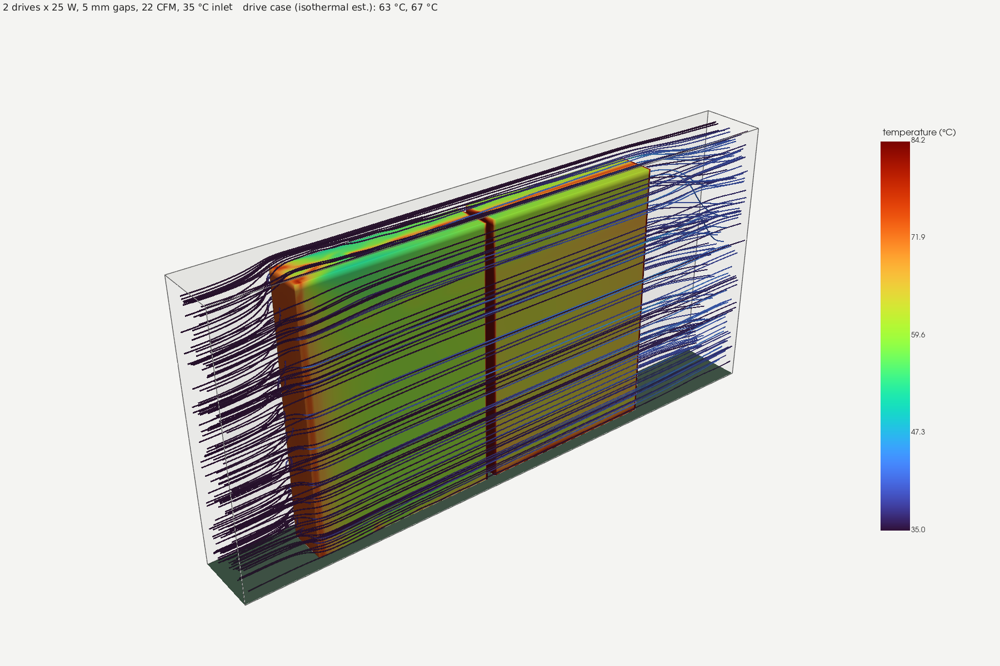
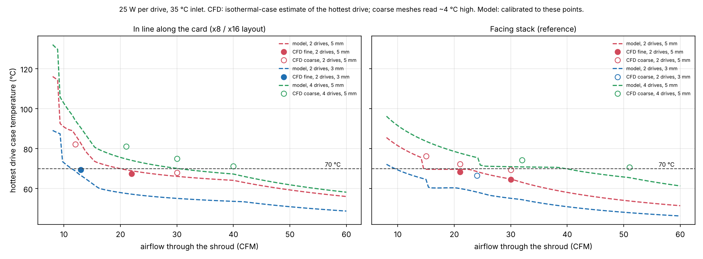
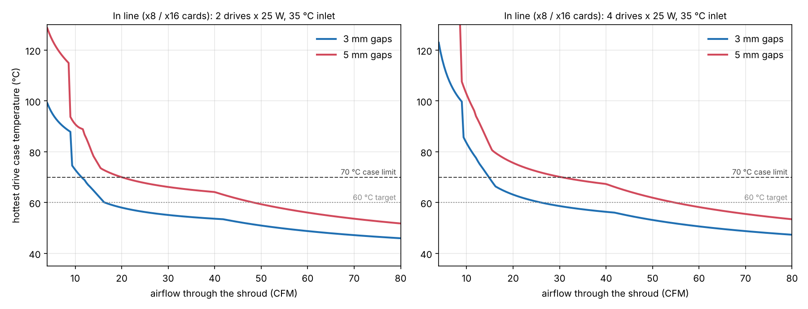
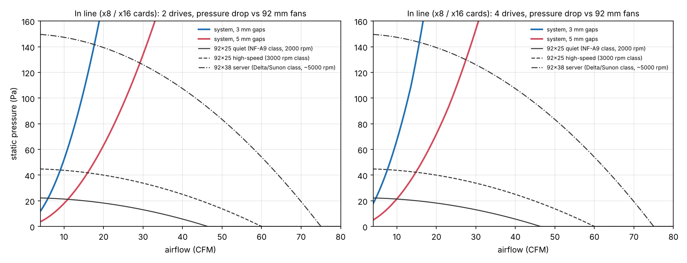
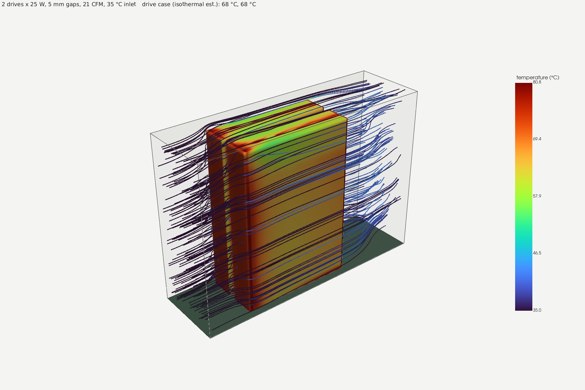
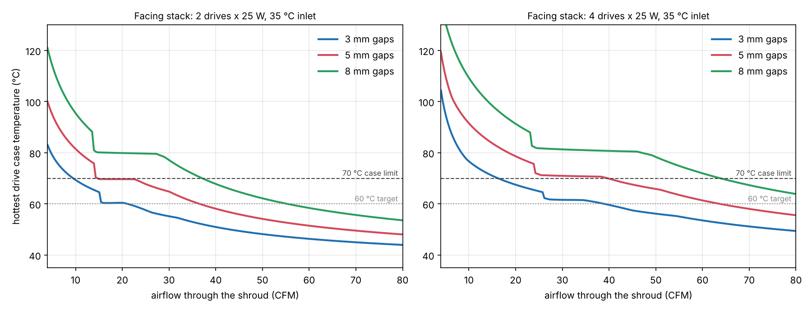

# Thermal analysis: U.3 drives on the x8 / x16 cards

How much air do 2 or 4 PM1735a-class U.3 drives at ~25 W each need on the adapter cards inside a
3D-printed shroud, and which 92 mm fan delivers it?



## Short answer

The x8 and x16 cards hold the drives side by side in the card plane (73 mm pitch, 3.15 mm apart),
so air running along the card passes the drives **one after the other**. All numbers are for
25 W per drive, 35 °C air into the shroud and a 70 °C case limit, with 5 mm between each drive
face and the shroud wall.

| Card | Airflow for 70 °C | With a 92x38 server fan (~150 Pa) | With a 92x25 fan |
| --- | --- | --- | --- |
| **x8, 2 drives** | ~20 CFM | ~29 CFM, hottest drive ~66 °C | 73–89 °C, not enough |
| **x16, 4 drives** | ~30 CFM | ~28 CFM, hottest drive ~71 °C (marginal) | 83–103 °C, not enough |

- The in-line path has a high pressure drop (~70 Pa at 22 CFM for 2 drives, ~150 Pa at 30 CFM
  for 4), because all the air squeezes past the drives through two 5 mm channels. Only a
  server-class 92x38 mm fan has the pressure for it.
- The last drive in the row runs hottest. With 4 drives it is ~8 °C hotter than the first.
- **3 mm gaps** to the shroud wall help a lot: about 11 CFM (2 drives) and 15 CFM (4 drives) for
  70 °C, and a server fan holds 59 °C / 68 °C. They need a stiff, accurate shroud.
- **At 20 W per drive** (a lower NVMe power state), 4 drives need ~17 CFM and a server fan holds ~64 °C.
- The 3.15 mm slots between neighbouring drives hold stagnant air (see the slices). Close them
  with a printed fin or foam so no air short-circuits there; it costs nothing.
- Blowing across the card instead (air along the 100 mm drive length, every drive gets fresh
  air) is not better for 4 drives: it needs ~47 CFM through a 300 mm wide duct, ~66 °C with a server fan.

Earlier versions of this page modelled the drives as a facing stack (big faces towards each
other, air through the gaps between them). That is not how the cards are built; the stack
results are kept below as a reference.

## Geometry and assumptions

| Item | Value |
| --- | --- |
| Drive | 2.5" U.3, 100 x 69.85 x 15 mm, aluminium case |
| Layout (in line) | drives in the card plane, 69.85 mm side along the card, 3.15 mm apart; air flows along the card past drive 1, 2, …; `gap` mm between each 100 x 69.85 face and the shroud; 5 mm bypass over the drive tops |
| Layout (stack, reference) | drives side by side with their big faces parallel, `gap` between faces and to the walls |
| Heat | 25 W per drive, all by convection (conduction into the card and connector ignored, conservative) |
| Inlet air | 35 °C (warm case interior in a Jonsbo N5 under load) |
| Limits | 70 °C drive case (typical enterprise SSD limit), 60 °C target for margin |
| Air | ρ 1.12 kg/m³, cp 1007 J/kgK, k 0.0275 W/mK, ν 1.7e-5 m²/s (~40 °C) |
| Fans | parabolic fits through free-air flow and max static pressure: 92x25 quiet 46 CFM / 22 Pa; 92x25 3000 rpm 60 CFM / 45 Pa; 92x38 server 75 CFM / 150 Pa. Class approximations, not a specific model. |

## CFD ([`tools/thermal/foamcase.py`](../../tools/thermal/foamcase.py))

OpenFOAM v1912, `buoyantSimpleFoam` (steady, energy equation), k-ω SST turbulence, gravity off.
The domain is the shroud interior: a 30 mm inlet plenum, the drives, and a 50 mm outlet. The drives
are cut out of a structured hex mesh and carry a uniform heat flux of 25 W over their wetted area.
The fan is a uniform-velocity inlet; the shroud and card are adiabatic walls. "Fine" meshes have
0.625 mm cells across the gaps; "coarse" ones 0.83 mm and read ~4 °C high (checked on two cases
run on both meshes). The coarse 4-drive case was run 800 iterations longer to check
convergence; the drive temperatures moved less than 0.5 °C.

**Which temperature.** A uniform-flux wall gets very hot wherever the air is stagnant (the slots
between drives, the trailing faces), so its area-mean temperature overstates a real aluminium
case, which spreads the heat. The table therefore gives the **isothermal-case estimate**: the
local heat-transfer coefficient h = q / (T_wall − T_air) is taken from the CFD, and the case
temperature that sheds 25 W through those h values is T_air + P / Σ(h·A). The plain area mean
is listed as the pessimistic bound. The real drive sits between the two, close to the first.

| layout | mesh | drives | gap | airflow | inlet speed | drive case, isothermal (°C) | area mean, uniform flux (°C) | Δp (Pa) | air out (°C) |
| --- | --- | --- | --- | --- | --- | --- | --- | --- | --- |
| inline | fine | 2 | 3 mm | 13 CFM | 2.78 m/s | 64, 69 | 71, 76 | 86.4 | 39.5 |
| inline | fine | 2 | 5 mm | 22 CFM | 3.96 m/s | 63, 67 | 70, 74 | 71.7 | 38.2 |
| inline | coarse | 2 | 5 mm | 12 CFM | 2.16 m/s | 75, 82 | 88, 94 | 25.2 | 40.3 |
| inline | coarse | 2 | 5 mm | 30 CFM | 5.39 m/s | 67, 68 | 74, 75 | 113.1 | 37.5 |
| inline | coarse | 4 | 5 mm | 21 CFM | 3.78 m/s | 69, 73, 78, 81 | 78, 89, 95, 90 | 84.6 | 41.2 |
| inline | coarse | 4 | 5 mm | 30 CFM | 5.39 m/s | 67, 69, 73, 75 | 74, 83, 87, 83 | 147.9 | 39.3 |
| inline | coarse | 4 | 5 mm | 40 CFM | 7.19 m/s | 65, 66, 69, 71 | 70, 78, 82, 79 | 237.3 | 38.4 |
| stack | fine | 2 | 5 mm | 21 CFM | 2.10 m/s | 68, 68 | 71, 71 | 25.9 | 38.3 |
| stack | fine | 2 | 5 mm | 30 CFM | 3.00 m/s | 65, 65 | 67, 67 | 49.6 | 37.3 |
| stack | coarse | 2 | 3 mm | 24 CFM | 2.77 m/s | 66, 66 | 69, 69 | 97.8 | 37.7 |
| stack | coarse | 2 | 5 mm | 15 CFM | 1.50 m/s | 76, 76 | 79, 78 | 14.6 | 38.8 |
| stack | coarse | 2 | 5 mm | 21 CFM | 2.10 m/s | 72, 72 | 74, 75 | 24.2 | 38.5 |
| stack | coarse | 2 | 5 mm | 30 CFM | 3.00 m/s | 69, 69 | 71, 72 | 49.5 | 37.1 |
| stack | coarse | 4 | 5 mm | 32 CFM | 1.69 m/s | 73, 74, 74, 73 | 75, 76, 76, 75 | 22.4 | 39.3 |
| stack | coarse | 4 | 5 mm | 51 CFM | 2.70 m/s | 69, 71, 71, 69 | 71, 73, 73, 71 | 52.0 | 37.9 |

| 2 drives in line, 22 CFM (fine mesh) | 4 drives in line, 21 CFM (coarse mesh) |
| --- | --- |
|  |  |



The air speeds up to 10–14 m/s in the two side channels, the slots between drives are dead air,
and the hot boundary layer from each drive carries on to the next one, which is why the
downstream drives run hotter than the bulk air rise (~1.5 K per drive at 30 CFM) suggests.

## Analytical model ([`tools/thermal/analytic.py`](../../tools/thermal/analytic.py))

A 1-D network model, fast enough to sweep fans, gaps and power. Parallel-plate channels
(Dh = 2 x gap), Stephan developing laminar / Gnielinski turbulent Nusselt numbers, each drive an
isothermal wall in an effectiveness-NTU balance with the air heated by the drives upstream, Shah
developing-flow friction plus entry, exit and funnel losses.

**Calibration** ([`calibrate.py`](../../tools/thermal/calibrate.py), [`cal.json`](../../tools/thermal/cal.json)):
the textbook correlations do not capture the in-line flow. Per layout, the model's h is scaled by
a·(Re/5000)^b fitted to the CFD isothermal-case temperatures, and its pressure drop by one factor
fitted to the fine-mesh cases. Result: in line a = 0.97, b = −0.64 (h rises only weakly with
airflow, as in the CFD), rms error 3.3 °C over 7 cases; stack a = 0.95, b = −0.46, rms 1.6 °C over
8 cases; Δp x 0.57. The correction is clamped to the Reynolds range the CFD covered, and the
in-line tables stop at 5 mm gaps because no wider in-line case was simulated.



### In line (x8 / x16 cards)





Hottest drive at each fan's operating point (35 °C inlet, 25 W per drive):

| drives | gap | CFM for 70 °C | CFM for 60 °C | 92x25 quiet (NF-A9 class, 2000 rpm) | 92x25 high-speed (3000 rpm class) | 92x38 server (Delta/Sunon class, ~5000 rpm) |
| --- | --- | --- | --- | --- | --- | --- |
| 2 | 3 mm | 11.4 | 16.4 | 93 °C @ 6 CFM | 88 °C @ 9 CFM | 59 °C @ 18 CFM |
| 2 | 5 mm | 20.0 | 48.4 | 89 °C @ 11 CFM | 73 °C @ 16 CFM | 66 °C @ 29 CFM |
| 4 | 3 mm | 14.8 | 26.0 | 117 °C @ 5 CFM | 103 °C @ 8 CFM | 68 °C @ 16 CFM |
| 4 | 5 mm | 30.4 | 54.7 | 103 °C @ 10 CFM | 83 °C @ 15 CFM | 71 °C @ 28 CFM |

Sensitivity (in line, 5 mm gaps, airflow for a 70 °C case):

| Power per drive | 2 drives | 4 drives | 4 drives, server fan |
| --- | --- | --- | --- |
| 15 W | 9 CFM | 12 CFM | ~57 °C |
| 20 W | 14 CFM | 17 CFM | ~64 °C |
| 25 W | 20 CFM | 30 CFM | ~71 °C |

| Inlet air | 2 drives | 4 drives |
| --- | --- | --- |
| 25 °C | 14 CFM | 16 CFM |
| 30 °C | 15 CFM | 21 CFM |
| 35 °C | 20 CFM | 30 CFM |
| 40 °C | 35 CFM | 44 CFM |

### Facing stack (reference)





| drives | gap | CFM for 70 °C | CFM for 60 °C | 92x25 quiet (NF-A9 class, 2000 rpm) | 92x25 high-speed (3000 rpm class) | 92x38 server (Delta/Sunon class, ~5000 rpm) |
| --- | --- | --- | --- | --- | --- | --- |
| 2 | 3 mm | 9.5 | 21.1 | 68 °C @ 11 CFM | 60 °C @ 16 CFM | 56 °C @ 29 CFM |
| 2 | 5 mm | 14.7 | 36.5 | 70 °C @ 18 CFM | 67 °C @ 25 CFM | 57 °C @ 43 CFM |
| 2 | 8 mm | 37.1 | 55.3 | 80 °C @ 26 CFM | 71 °C @ 36 CFM | 60 °C @ 56 CFM |
| 4 | 3 mm | 16.2 | 39.0 | 69 °C @ 17 CFM | 65 °C @ 25 CFM | 58 °C @ 44 CFM |
| 4 | 5 mm | 39.7 | > 60 | 71 °C @ 27 CFM | 71 °C @ 37 CFM | 62 °C @ 57 CFM |
| 4 | 8 mm | > 60 | > 60 | 81 °C @ 35 CFM | 80 °C @ 47 CFM | 69 °C @ 66 CFM |

## Re-running

```sh
python3 tools/thermal/analytic.py docs/thermal                                  # seconds, uses cal.json
python3 tools/thermal/foamcase.py /tmp/case --layout inline --drives 4 --gap 5 --cfm 30 --run   # 5-30 min on 4 cores
python3 tools/thermal/sweep.py /tmp/sweep && python3 tools/thermal/sweep_inline.py /tmp/sweep
python3 tools/thermal/calibrate.py /tmp/sweep                                   # refits cal.json
python3 tools/thermal/plot_cfd.py /tmp/sweep docs/thermal
xvfb-run -a python3 tools/thermal/render_cfd.py /tmp/sweep/<case> docs/thermal/cfd_3d_<case>.png
```

Ubuntu 24.04: `apt install openfoam` (v1912). That build aborts when any function object is
loaded, so the scripts parse the written fields instead of using function objects.

## Limits of this analysis

- Fan curves are class approximations. Replace them with the chosen fan's datasheet curve.
- The shroud is idealised (straight duct, uniform inlet). A real funnel from a 92 mm fan adds loss
  and uneven flow; the model adds 0.3 dynamic heads for it.
- Heat leaving through the connector into the card is ignored (conservative by a few °C).
- The x16 card raises drives B–D by 5.7 mm; the model and CFD keep all drives at one height.
- The drive's internal temperature (controller, NAND) runs above the case. The drive reports its
  composite temperature over NVMe (`nvme smart-log`); check it under load once built.
