# mech: 3D models, fan shrouds and assemblies

Parametric mechanical models for every board in this repo: the drives and connectors, the
3D-printable fan shrouds, and full assemblies with bracket, fans and screws. Everything is
generated by Python ([CadQuery](https://github.com/CadQuery/cadquery) for the solids, Blender
Cycles for the renders) straight from the KiCad board files, so it is rebuilt, not redrawn, when a
board changes. All designs are built around 120 mm fans.

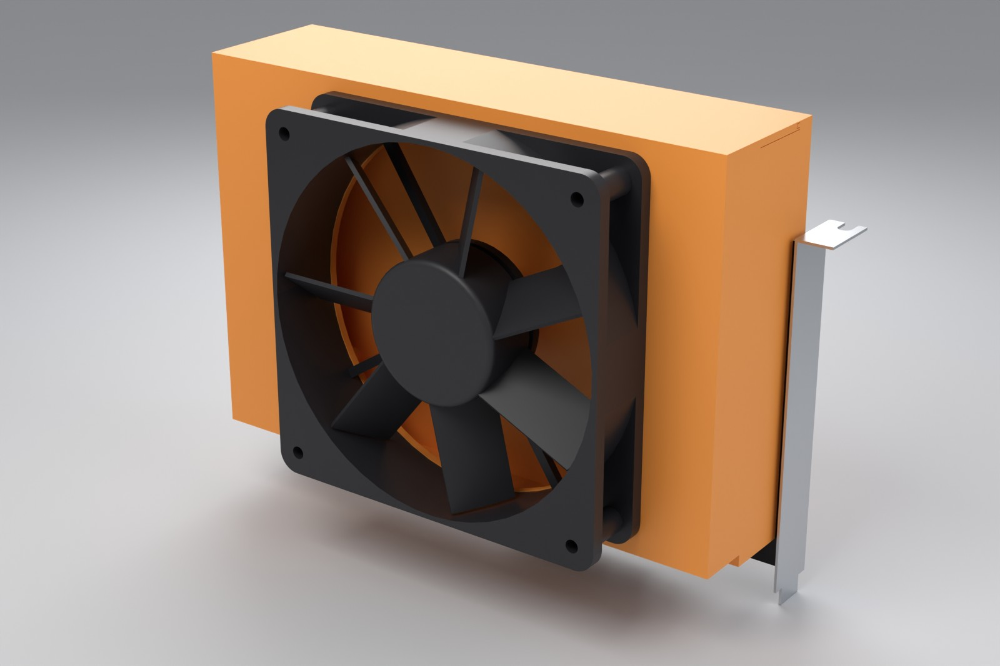

| Assembly | What | Fans | Status |
| --- | --- | --- | --- |
| `x8`, `x16p3`, `x16p` | slot card with 2 / 3 / 4 drives, **end-fan** shroud | one 120 mm at the card end | from the board file |
| `x8_top`, `x16p3_top`, `x16p_top` | the same cards, **top-feed** shroud | one 120 mm per 2 drives, behind the drives | from the board file |
| `x8_end3` | three cards in neighbouring slot pairs on **one shared end fan** | one 120 mm for 6 drives | from the board file |
| `x8_hood3`, `x16p_hood3` | three cards under **one shared hood** | one 120 mm per 6 drives, on top | from the board file |
| `cage` | OCuLink cage board, 1 drive, sled | 60x25 | from the board file |
| `backplane`, `backplane6` | top-loading hot-plug cage for 4 / 6 drives behind a front case fan, 80 / 120 mm wide | the case's 120 mm front fan | from the board files |

Any card and card count works for the shared styles: `python3 mech/build.py x16p3_end2`.

Not modelled yet because no board files exist: the three SlimSAS host cards and the Minisforum
boards. They drop into `boards.json` when their layouts land.

This is a first mechanical design. Nothing here has been printed or test-fitted yet; see
[What is verified](#what-is-verified-and-what-is-not). The card layout may still change (drives on
the front or the back of the card); the card shrouds are regenerated from the board files then.

## Which fan works

Calibrated model in `tools/thermal`: 25 W per drive, 35 °C air in, 70 °C limit, 5 mm air gaps.
Fan curves are class approximations and none of these layouts has had its own CFD run, so read
the numbers as ± 5 °C. Hottest drive in °C:

| Layout | quiet 120x25 (60 CFM, 20 Pa) | Arctic P12 Max class (81 CFM, 43 Pa) | Noctua iPPC-3000 class (110 CFM, 75 Pa) | 120x38 server |
| --- | --- | --- | --- | --- |
| End fan, x8 / x16 3 drives / x16 4 drives | 89 / 94 / 102 | 73 / 78 / 84 | 69 / 73 / 76 | 65 / 67 / 70 |
| Top-feed, any card | 77 | 71 | 65 | 55 |
| Shared end fan, 3 x8 cards | 93 | 79 | 71 | 67 |
| Shared hood, 3 cards (6 drives per fan) | 94 | 77 | 70 | 61 |
| Hot-plug cage, 4 / 6 drives | 71 / 72 | 70 / 71 | 64 / 66 | 55 / 58 |

- The end-fan duct is long and narrow, so it needs a high-pressure fan. A quiet 120 mm fan does
  not work there.
- Top-feed gives every drive fresh air over a short path and works with ordinary high-pressure
  120 mm fans.
- Sharing one fan between three cards costs only 1 to 6 °C, because the fans are limited by
  pressure, not by flow.
- At 15 W per drive (typical for a PM1735 that is not writing flat out) every layout except the
  end fan with a quiet fan stays at or below 60 °C.
- Blowing a fan flat onto the drives without channels does not work (about 70 K rise by estimate).
  All shrouds therefore form a 5 mm channel on both big faces of every drive.

## Slot-card shrouds

The drives hang on the back of the card and stand up from the connector strip. In every style the
card gets a **body** behind the drives and a **cover** over the card window in front of them; four
M3x10 screws per drive go through printed pillars in the cover into the drive's bottom mounting
holes. That holds every drive and sets the 5 mm gaps. Body, card and cover are clamped with M3x12
screws through the card's M3 slots into heat-set inserts. **Slot fillers** close the 3.15 mm slots
between neighbouring drives. Parts on the card are cut out of the print automatically with 0.5 mm
clearance. Parts longer than 250 mm are split between two drives.

### End fan (`x8`, `x16p3`, `x16p`)

Air runs along the card from a fan beyond the far card end to the bracket, the "in line" layout of
the CFD in [`docs/thermal`](../docs/thermal/). A 50 mm funnel takes the duct (about 25 x 105 mm) to
the fan. Air leaves at the bracket end: the back channel towards the neighbouring slot (remove
that slot cover), the front channel through slots in the cover.

| x8 | x16, 4 drives | exploded |
| --- | --- | --- |
| 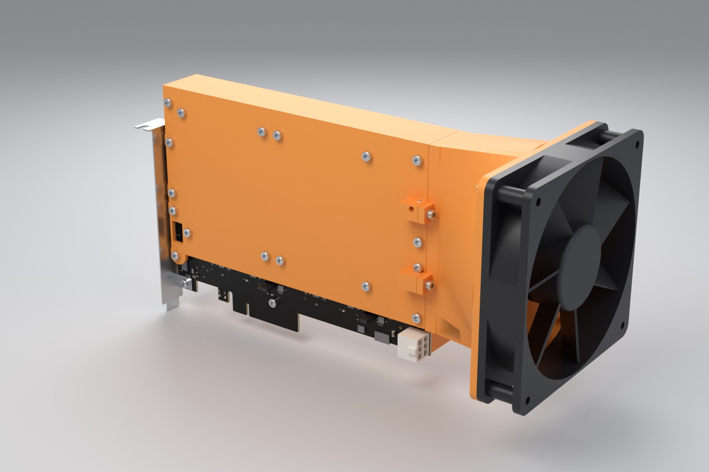 | 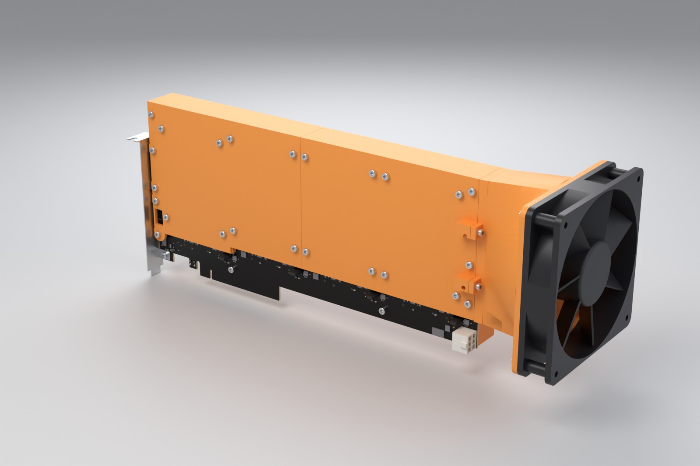 | 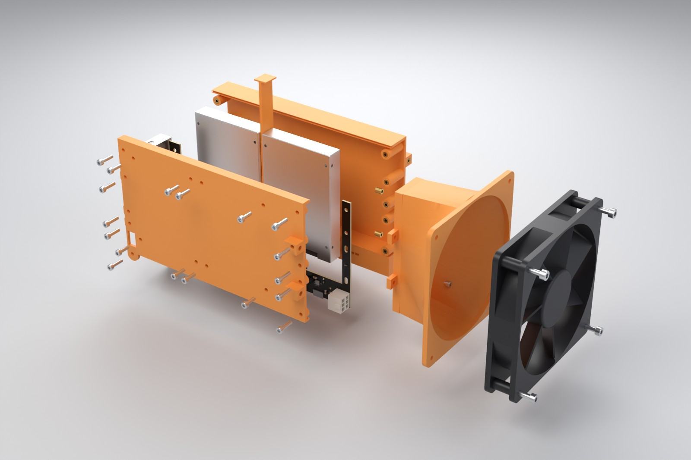 |

### Top-feed (`*_top`)

One 120 mm fan per two drives lies flat behind the drives. Air goes into a 16 mm chamber, over the
drive ends, and down both faces of every drive to the connector strip. No added length.

| x8 | x16, 4 drives, see-through | exploded |
| --- | --- | --- |
|  | 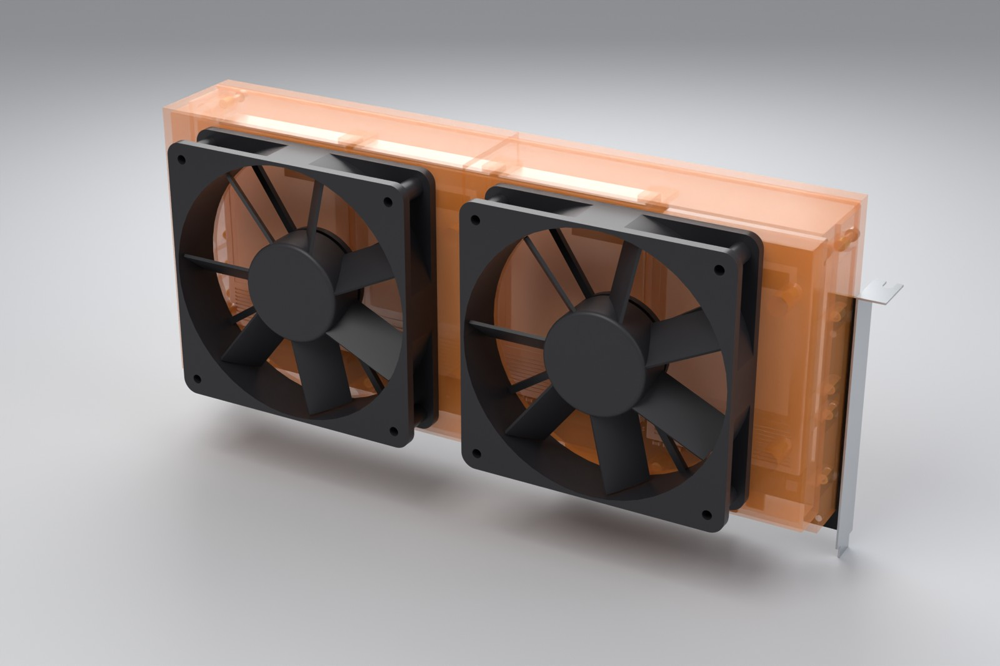 | 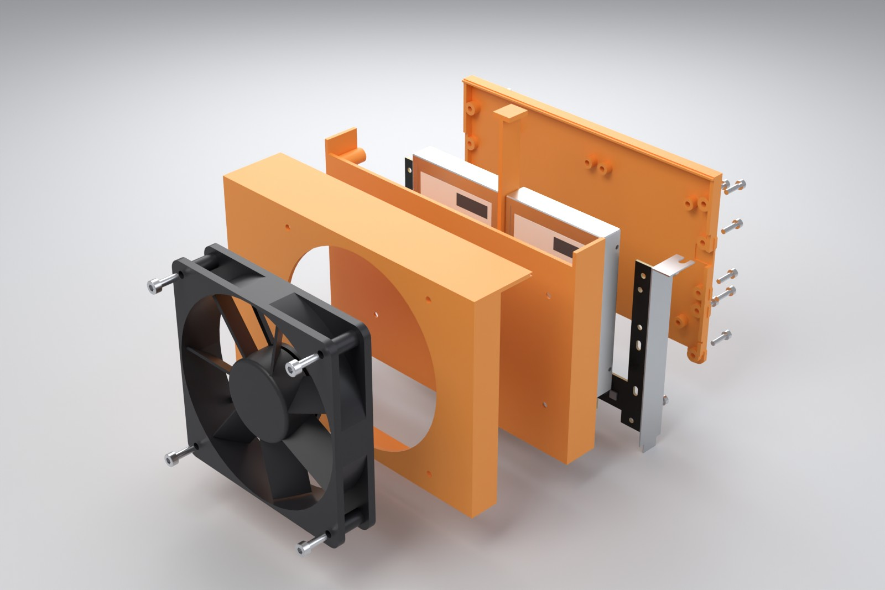 |

### Shared end fan (`*_end<n>`)

A card with its drives is two slots thick, so the cards sit 40.64 mm apart. Each card keeps its
end-fan body and cover. One adapter plate bolts to all cards, closes the gaps between them and
funnels all ducts to one fan. Three cards are 111 mm wide, almost exactly one 120 mm fan.

| three x8 cards | see-through |
| --- | --- |
| 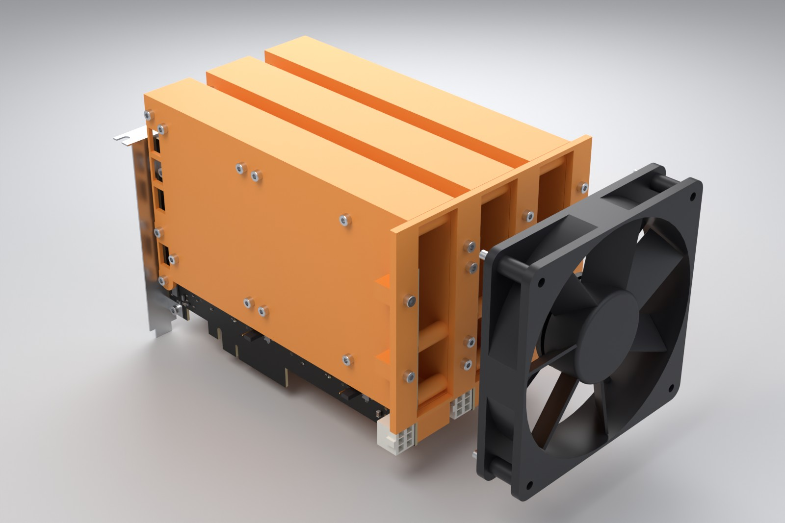 | 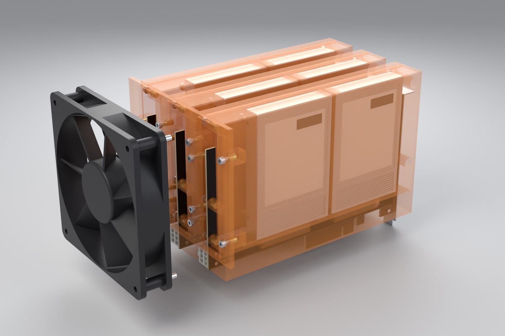 |

### Shared hood (`*_hood<n>`)

Each card gets the top-feed body and cover without the fan chamber, open at the top. A hood lies
across all cards with one fan per two drives of card length blowing down, so one fan feeds 6
drives with three cards, and two fans feed the 12 drives of three 4-drive cards. The hood hooks
into each card at the bracket end and takes one M3 screw per card at the far end.

| three x16 cards, 12 drives | three x8 cards, see-through | exploded |
| --- | --- | --- |
| 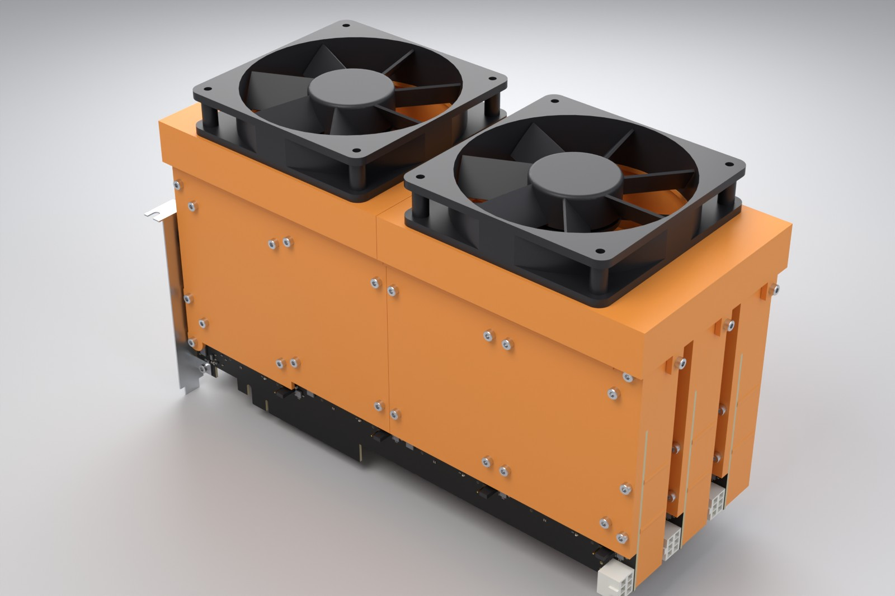 | 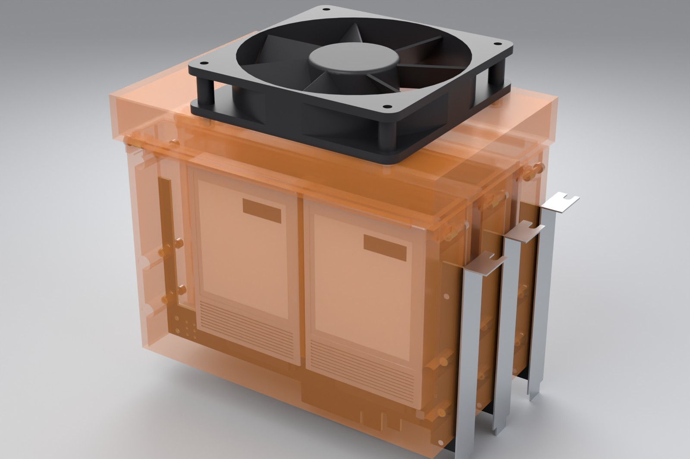 | 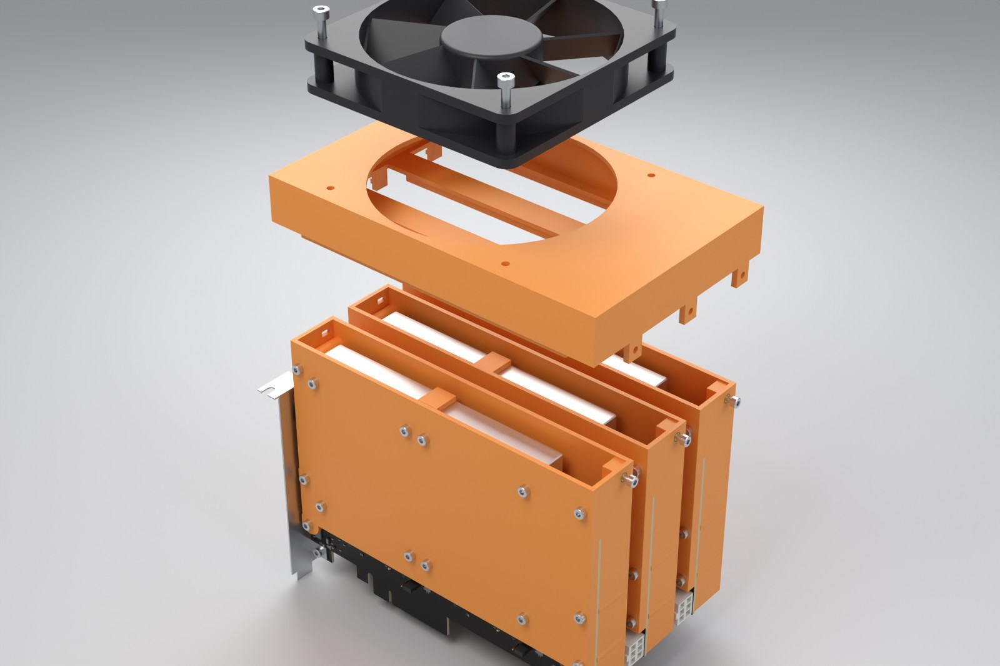 |

### Envelope

Length from the bracket-end card edge, height from the bottom of the gold fingers.

| | Length | Height | Thickness |
| --- | --- | --- | --- |
| End fan, x8 / x16 3 drives / x16 4 drives | 276 / 325 / 398 mm | 138 / 144 / 144 mm at the card, 145 / 150 / 150 mm at the fan | 30 mm at the card; the fan reaches 51 mm in front of the card and 69 mm behind it |
| Top-feed, x8 / x16 3 drives / x16 4 drives | 190 / 275 / 312 mm | 147 / 153 / 153 mm | 6 mm in front of the card, 66 mm behind it |
| Shared end fan, 3 x8 cards | 263 mm | 145 mm | 134 mm over all three cards |
| Shared hood, 3 x8 / 3 x16 4-drive cards | 193 / 315 mm | 193 / 198 mm | 124 mm over all three cards |

The drives alone already stand 23 to 29 mm above a full-height card (111 mm). The hood adds
another 50 mm on top, so it needs a case with about 205 mm above the motherboard at the slots; it
does not fit under a 160 mm cooler limit. The end-fan styles add length instead.

## Top-loading hot-plug cage (`backplane`, `backplane6`)

For the top front compartment of a Jonsbo N5: the cage bolts onto the rear holes (105 mm pattern)
of a front 120 mm case fan. The backplane lies flat at the bottom with the receptacles up, the
drives go in from the top with the connector down, standing side by side at 20 mm pitch. The fan
blows through the 5 mm gaps across the drives' width. Six drives are exactly 120 mm, so the
6-drive cage is one fan wide and two of them hold 12 drives behind the two fans. The 4-drive cage
is 80 mm wide, so modules tile at the board pitch.

| 6 drives, lid off | see-through | exploded | 4 drives |
| --- | --- | --- | --- |
| 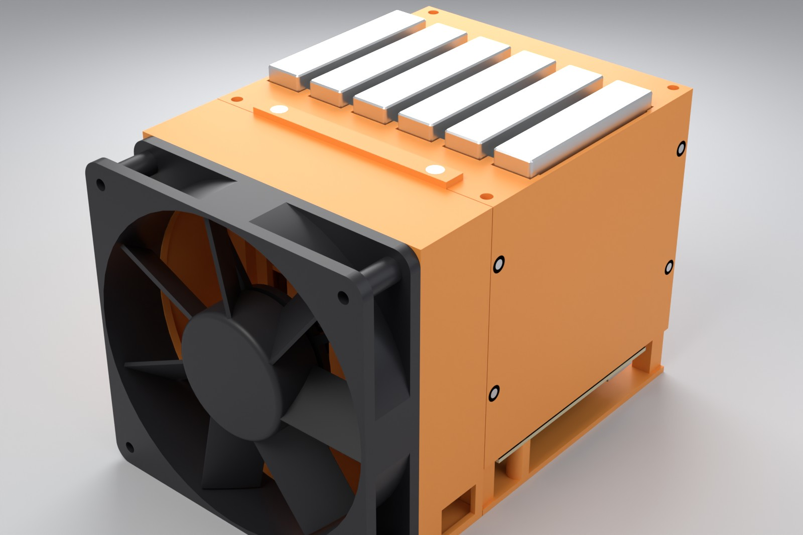 | 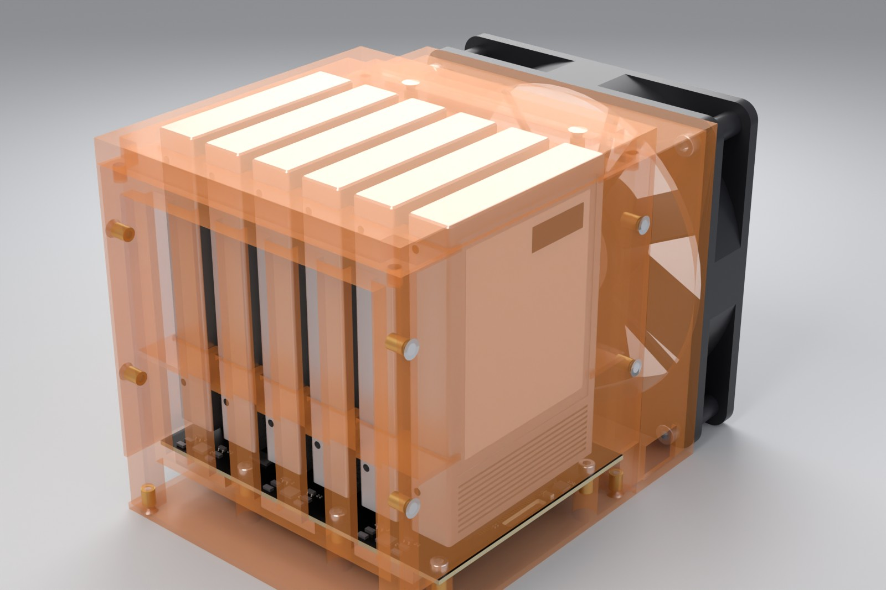 | 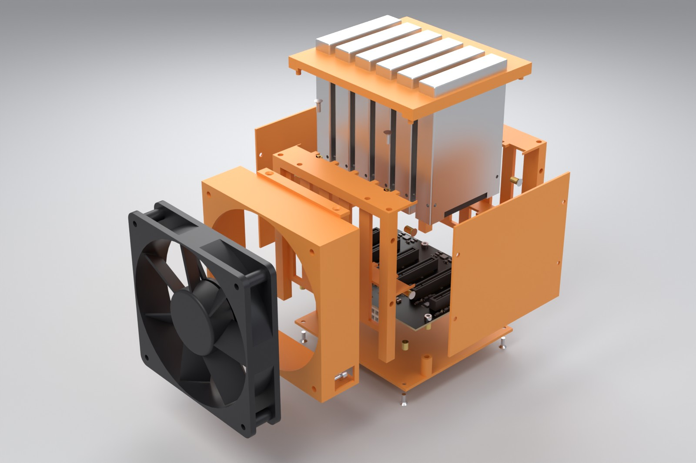 | 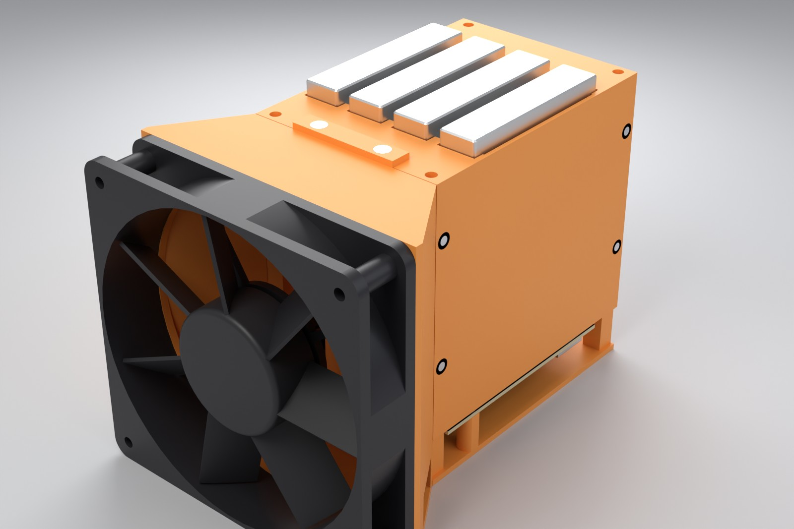 |

- **Fan duct**: flange on the fan and a 34 mm duct. The Mini-Fit and fan plugs on the fan-side
  board edge have 39.5 mm of room inside it; the wires leave through openings in both side walls.
- **Base**: floor with 15 mm standoffs under the board's M3 holes (M3x6 from the drive side into
  inserts). The cable connectors on the underside have 15 mm of height.
- **Combs** front and rear: a bar in front of every drive and two guide shelves with a notch per
  drive. They stand outside the board's long edges and touch nothing on the board.
- **Side plates**, 1.6 mm, with 0.9 mm beside the outer drives.
- **Lid**: drops onto four pegs and keeps the air in the gaps. Lift it off to swap a drive. The
  drives stand 6 mm above the combs so they can be gripped.
- Assembly: screw the duct to the fan first (fan screws from the duct side), then drop the
  finished cage in and fix it with two screws from the top.

Size with the fan: 120 x 173 x 128 mm (width x depth x height); the fan's bottom edge is level
with the cage's underside. The drives are held by the connector and gravity, and by the lid.

Open points: the outer faces of the two outer drives get almost no air (0.9 mm gap), which the
thermal model does not cover; without the lid, air escapes upwards and the rear half of each drive
runs hotter; the height of the case's fan above the compartment floor is not known, so the fan
position is a parameter (`fan` centre at half the fan size above the underside).

Both cages are generated from the routed boards: receptacle and hole positions are read from the
board files, and the build checks that no printed part touches a part on the board
(`board_part_clashes_mm3` in the manifest, empty for both).

## Single-drive sled (`cage`)

Tray with side walls, lid and a funnel to a 60x25 fan for the OCuLink cage board. The board screws
onto four pillars through its M3 slots, the drive onto four pillars through its bottom holes. The
model gives about 67 °C for one 25 W drive with a 5000 rpm 60x25 fan.

| | |
| --- | --- |
| 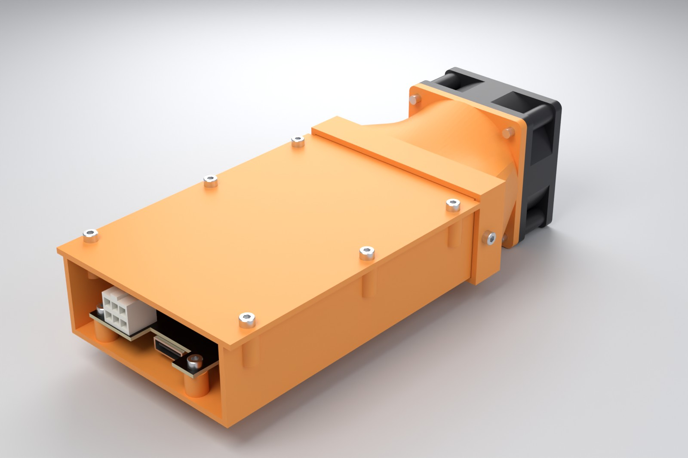 | 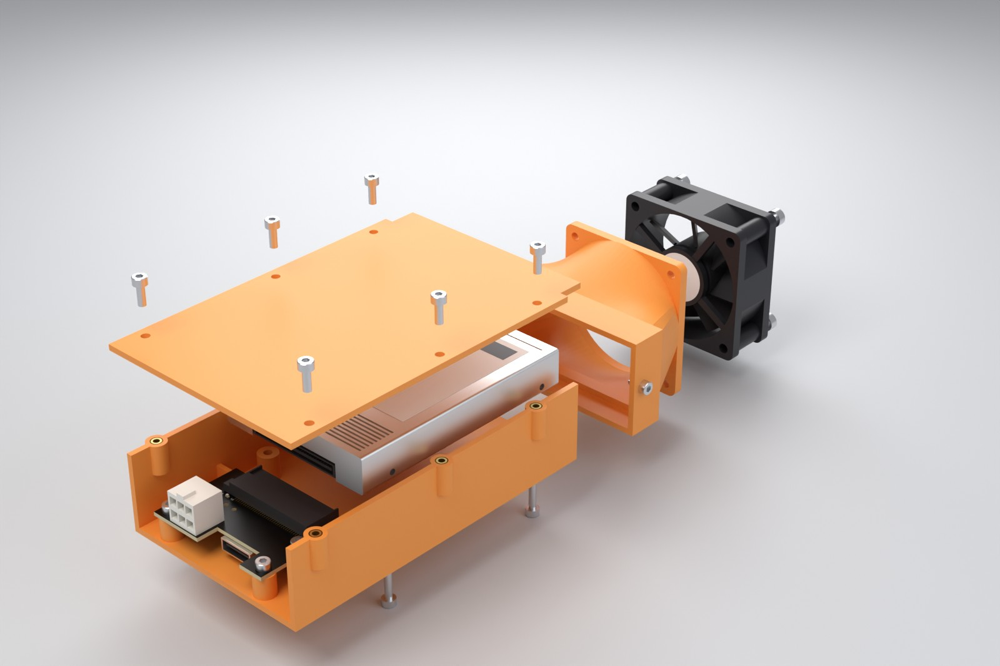 |

## Files

| Path | What |
| --- | --- |
| `out/<assembly>/print/*.stl`, `*.step` | printable parts, in assembly position; for the shared styles every different part once |
| `out/<assembly>/<assembly>_assembly.step.zip` | full assembly: boards, connectors, drives, printed parts, bracket, fans, screws (coloured STEP) |
| `out/<assembly>/manifest.json` | board commit, parameters, envelope, bill of materials, print volumes, interference check |
| `out/parts/*.step` | the bought parts on their own |
| `../docs/img/mech/` | renders |

Small SMD parts are in the renders but not in the assembly STEP.

## Printing

- PETG at least, ASA or ABS better: the drives run at up to 70 °C. PLA softens at that temperature.
- 0.4 mm nozzle, 0.2 mm layers, 4 perimeters, 20 % infill. Walls are 2.4 mm.
- Card body: back wall on the bed. Cover: outer face on the bed. Fan adapters and the hood: fan
  flange on the bed. Slot fillers: flat. Cage combs and side plates: outer face on the bed. Base
  and lid: flat. Fan duct: flange on the bed.
- M3 heat-set inserts (4.6 mm OD x 5.7) go into the 4.0 mm holes with a soldering iron.

## Rebuilding

```sh
# Ubuntu 24.04: apt install kicad xvfb ; pip install cadquery bpy pyvista trimesh shapely mapbox_earcut pillow
python3 mech/build.py                  # all assemblies: STEP, STL, manifest (about 10 min)
python3 mech/build.py parts            # bought-part STEP library
python3 mech/build.py x8 --preview     # one assembly, plus quick previews (needs xvfb-run)
python3 mech/render.py                 # Cycles renders into docs/img/mech (2 to 3 min per image on 4 cores)
python3 mech/render.py x8 --views hero xray --samples 64
```

`boards.json` lists each board with the git ref it is read from. The boards are owned by other
branches, so `mech/` reads them with `git show` and never edits a board. The cards are read from
`main` (rev F cards and both backplanes), the OCuLink cage board from its PR branch. After those branches
merge, point the refs at `WORKTREE`.

| File | What |
| --- | --- |
| `parts.py` | drive, connectors, fans, bracket, screws: parametric models and materials |
| `boardio.py` | reads a board (outline, holes, footprints, part heights) into the board frame, seats the drives |
| `card_shroud.py` | end-fan shroud, `ShroudParams` |
| `card_shroud_top.py` | top-feed shroud, `TopParams` |
| `card_shroud_multi.py` | shared end fan and shared hood for several cards |
| `sled.py` | single-drive sled, `SledParams` |
| `backplane_cage.py` | hot-plug cage, `BackplaneSpec`, `CageParams` |
| `build.py` | export, bill of materials, interference check |
| `render.py`, `scene.py`, `preview.py` | Cycles renders, mesh conversion, fast previews |

Board frame: origin at the lower-left corner of the outline seen from the component side, x right,
y up, z = 0 on the component-side surface. For the cards x = 0 is the bracket-end edge and y = 0
the bottom of the gold fingers.

## What is verified and what is not

| Item | Source | Confidence |
| --- | --- | --- |
| Board outline, holes, part positions | the KiCad files | exact |
| Drive seat on the right-angle receptacle: end face 10.05 mm from the peg line | Amphenol PSAS4F213002 drawing, as used by the card layout | good |
| Drive bottom face flush with the receptacle's mounting surface (plug centre 3.5 mm up) | project notes; to be measured on a real adapter | **unverified, ±1 mm** |
| Drive envelope 100.45 x 69.85 x 15, bottom holes 61.72 mm apart at 14.0 and 90.6 mm from the connector end | SFF-8201 values from memory; the spec could not be fetched from here | **check against a drive before printing** |
| Plug centred on the drive width | assumption shared with the board layout | **check** |
| Vertical receptacle PSAS5F313: 8.15 mm tall, drive end face 6.5 mm above the board | height from the datasheet; the drawing gives no mated height | **unverified** |
| Jonsbo N5 compartment and the position of its front fans | not measured | **unknown** |
| SlimSAS, OCuLink, Mini-Fit, fan, bracket models | envelope dimensions, appearance level | fine for renders, not for fit |
| Interference | checked numerically between printed parts, boards, drives, fans and bracket for every build (`manifest.json`) | no overlaps |
| Thermal numbers | calibrated 1-D model from `tools/thermal`; no CFD for the funnels, the top-feed, the hood or the cage | ± 5 °C, cage and hood rougher |

Before printing a full card shroud, print the cover alone and check it against a drive's four
bottom holes and the card's M3 slots: that one part tests every unverified card dimension. For the
cage, print one comb and check it against a drive standing in the receptacle.
