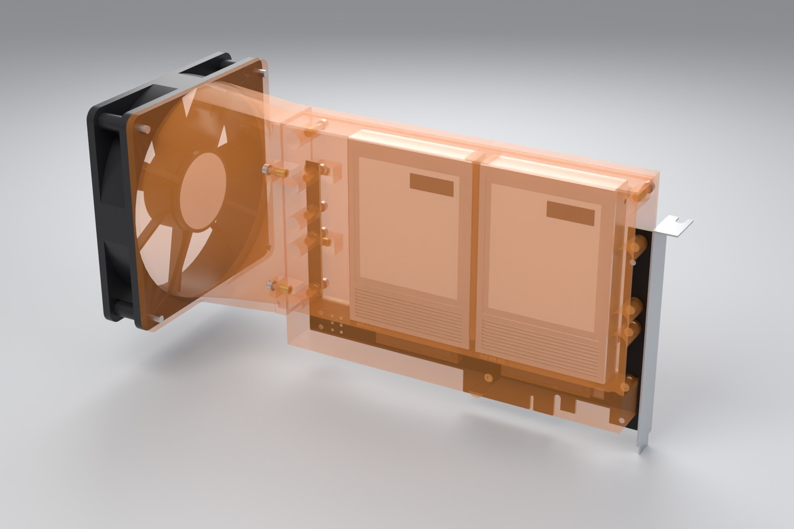
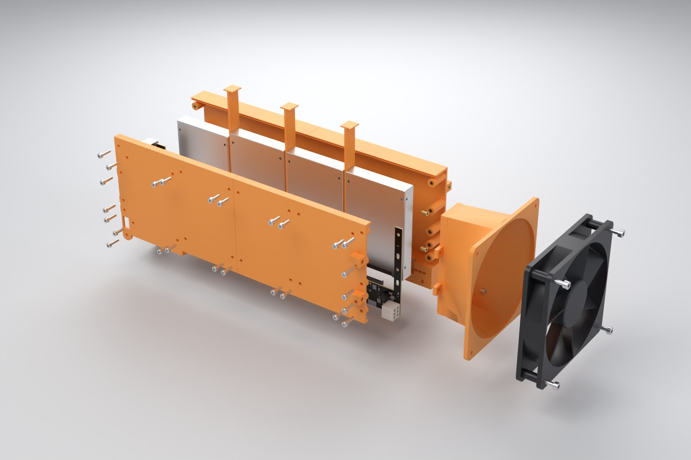
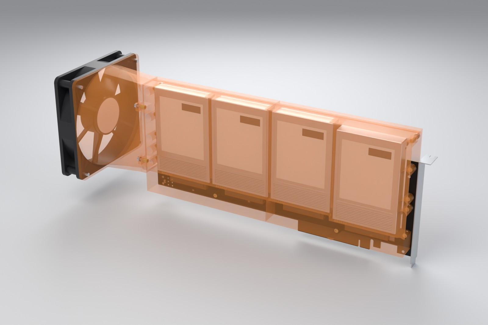
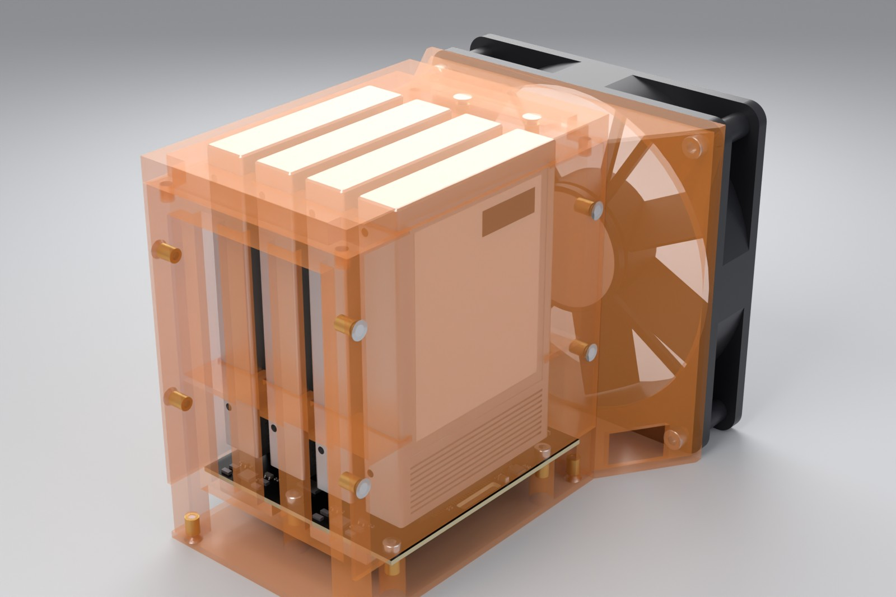

# mech: 3D models, fan shrouds and assemblies

Parametric mechanical models for every board in this repo: the drives and connectors, the
3D-printable fan shrouds, and full assemblies with bracket, fan and screws. Everything is
generated by Python ([CadQuery](https://github.com/CadQuery/cadquery) for the solids, Blender
Cycles for the renders) straight from the KiCad board files, so it is rebuilt, not redrawn, when a
board changes.


| Assembly | Board | Printed parts | Fan | Status |
| --- | --- | --- | --- | --- |
| `x8` | x8 card, 2 drives | body, cover, fan adapter, 1 slot filler | 92x38 | generated from the board file |
| `x16p3` | x16 card, 3 drives | body, cover, fan adapter, 2 slot fillers | 92x38 | generated from the board file |
| `x16p` | x16 card, 4 drives | body and cover in two halves, fan adapter, 3 slot fillers | 92x38 | generated from the board file |
| `cage` | OCuLink cage board, 1 drive | tray, lid, fan adapter | 60x25 | generated from the board file |
| `backplane` | cabled 4-drive backplane | cage, fan plate | 80x38 | **stand-in board** from the layout's reported geometry; the board file is not pushed yet |

Not modelled yet because no board files exist: the three SlimSAS host cards (passive, redriver,
retimer) and the Minisforum boards. They drop into `boards.json` when their layouts land.

This is a first mechanical design. Nothing here has been printed or test-fitted yet; see
[What is verified](#what-is-verified-and-what-is-not).

## Slot-card shroud (x8, x16)

| Component side | Drive side, shroud see-through |
| --- | --- |
|  |  |
|  |  |

The drives hang on the back of the card and stand up from the connector strip. The shroud turns
that row of drives into one flat duct. Air from a fan beyond the far card end runs along the card
towards the bracket, through a 5 mm channel on each big face of every drive. That is the "in line"
layout the CFD in [`docs/thermal`](../docs/thermal/) covers.

- **Body** (back of the card): back wall 5 mm behind the drives' label faces, top wall over the
  drive ends, bottom wall on the back of the connector strip. The space around the receptacles
  below the drives is filled, so the air cannot bypass the drives there.
- **Cover** (component side): a plate 5 mm in front of the drives' bottom faces, over the card
  window. Four M3x10 screws per drive go through printed pillars into the drives' bottom mounting
  holes. That holds every drive, sets the 5 mm gap and stiffens the plate. A skirt seals it to the
  card along the window edge; the connector strip with its jumpers and LEDs stays open.
- **Fan adapter**: 7 mm neck and a 38 mm funnel from the duct (about 25 x 105 mm) to the fan, bolted
  to lugs on body and cover with four M3x8.
- **Slot fillers**: bars that drop into the 3.15 mm slots between neighbouring drives. The CFD shows
  dead air there; closing the slots keeps the air in the two channels.
- Body, card and cover are clamped with M3x12 screws through the card's M3 slots into heat-set
  inserts in the body, plus one screw at each top corner beyond the card edge. A tongue along the
  cover's top wall sits in a groove in the body.
- Parts on the card are cut out of the print automatically with 0.5 mm clearance (jumper headers,
  the 6-pin, anything taller than the 3.4 mm under the cover).
- Body and cover longer than `max_len` (250 mm) are split midway between two drives, so the
  4-drive shroud prints as two halves.

**Exhaust.** Air leaves at the bracket end. The back channel is open towards the slot next to
the card: remove that slot cover or fit a vented one. The front channel leaves through slots in
the cover over the card's bracket-end column, into the case.

**Fan choice** (calibrated model in `tools/thermal`, 25 W per drive, 35 °C air in, 70 °C limit,
5 mm gaps; fan curves are class approximations):

| Card | 92x38 server fan | 80x38 server | 120x38 server | 92x25 or 120x25 quiet |
| --- | --- | --- | --- | --- |
| x8, 2 drives | 29 CFM, hottest drive 66 °C | 66 °C | 65 °C | 88–90 °C |
| x16, 3 drives | 28 CFM, 69 °C | 69 °C | 67 °C | 93–96 °C |
| x16, 4 drives | 27 CFM, 71 °C (marginal) | 71 °C | 69 °C | 100 °C and up |

The duct needs about 130 Pa at 28 CFM, which only 38 mm thick server-class fans deliver. A 92x38
is the default because a bigger fan gains almost nothing through this duct and a smaller one
(80x38) only makes the funnel easier. `ShroudParams.fan` switches the size. With four drives at a
full 25 W each the result is at the limit: 3 mm gaps (`gap=3.0`) or drives at 20 W bring it to
about 64–68 °C.

**Envelope** (x from the bracket-end card edge, y from the bottom of the gold fingers):

| | x8 | x16, 3 drives | x16, 4 drives |
| --- | --- | --- | --- |
| Length with funnel and fan | 277 mm | 326 mm | 399 mm |
| Height (top of the shroud) | 138.4 mm | 144.1 mm | 144.1 mm |
| Thickness at the card | 30 mm: 5.8 mm in front of the card, 22.4 mm behind it (the card's own slot plus the next one towards the CPU) |||
| Fan | 92 x 92 mm, centred on the duct: reaches 37 mm in front of the card and 53 mm behind it |||

The drives alone already stand 23–29 mm above a full-height card (111 mm), so the case needs about
150 mm of clear height above the motherboard at the slot. The 4-drive assembly is 399 mm long; where that does not
fit, the 3-drive card or a fan that blows in from the side are the options (not designed yet).

## Single-drive sled (OCuLink cage board)

| | |
| --- | --- |
|  |  |

Tray with side walls, lid and a funnel to a 60x25 fan. The board screws onto four pillars through
its M3 slots, the drive onto four pillars through its bottom holes (M3x12 from below, counterbored).
A baffle under the drive's connector end sends the air over and under the drive. The model gives
about 67 °C for one 25 W drive with a 5000 rpm 60x25 fan.

## 4-drive backplane cage

| | |
| --- | --- |
|  |  |

A tube around four drives at 20 mm pitch (5 mm between drives), guide ribs at the drive edges, an
80x38 fan on a plate at the front and vents next to the backplane. Each drive is held by M3x6
screws through slotted holes into its side mounting holes. The model gives about 63 °C for four
25 W drives with an 80x38 server fan (56 CFM at 60 Pa); an 80x25 fan at 3000 rpm ends at 71 °C.

The board in these pictures is a stand-in built from the geometry the backplane layout reported
on 2026-11-13 (79.6 x 84.5 mm, SlimSAS 8i and the 8-pin on the back, milled air slots). `BackplaneSpec`
in [`backplane_cage.py`](backplane_cage.py) holds every number the cage depends on; the real board
file replaces it once it is pushed. The board's slots give only about 450 mm² of exhaust, so the
cage has its own vents on three sides next to the board. The corner without a mounting hole
(the SlimSAS plug is in the way) rests on a ledge.

## Files

| Path | What |
| --- | --- |
| `out/<assembly>/print/*.stl`, `*.step` | printable parts, in assembly position |
| `out/<assembly>/<assembly>_assembly.step.zip` | full assembly: board, connectors, drives, printed parts, bracket, fan, screws (coloured STEP) |
| `out/<assembly>/manifest.json` | board commit, parameters, envelope, screw positions, bill of materials, print volumes, interference check |
| `out/parts/*.step` | the bought parts on their own: drive, connectors, fans, bracket, screw, insert |
| `../docs/img/mech/` | renders |

Small SMD parts are in the renders (from the KiCad library models) but not in the assembly STEP,
which carries the board, the connectors and everything mechanical.

## Printing

- PETG at least, ASA or ABS better: the drives run at up to 70 °C. PLA softens at that temperature.
- 0.4 mm nozzle, 0.2 mm layers, 4 perimeters, 20 % infill. Walls are 2.4 mm.
- Body: back wall on the bed. Cover: outer face on the bed. Fan adapter: fan flange on the bed.
  Slot fillers: flat. Backplane cage: backplane end on the bed. Tray and lid: flat.
- M3 heat-set inserts (4.6 mm OD x 5.7) go into the 4.0 mm holes with a soldering iron.

## Rebuilding

```sh
# Ubuntu 24.04: apt install kicad xvfb ; pip install cadquery bpy pyvista trimesh shapely mapbox_earcut pillow
python3 mech/build.py                  # all assemblies: STEP, STL, manifest (about 3 min)
python3 mech/build.py parts            # bought-part STEP library
python3 mech/build.py x8 --preview     # one assembly, plus quick previews (needs xvfb-run)
python3 mech/render.py                 # Cycles renders into docs/img/mech (about 2 min per image on 4 cores)
python3 mech/render.py x8 --views hero xray --samples 64
```

`boards.json` lists each board with the git ref it is read from. The boards are owned by other
branches (the card layout and the cage review), so `mech/` reads them with `git show` and never
edits a board. After those branches merge, point the refs at `WORKTREE`.

| File | What |
| --- | --- |
| `parts.py` | drive, connectors, fans, bracket, screws: parametric models and materials |
| `boardio.py` | reads a board (outline, holes, footprints, part heights) into the board frame, seats the drives |
| `card_shroud.py` | slot-card shroud generator, `ShroudParams` |
| `sled.py` | single-drive sled, `SledParams` |
| `backplane_cage.py` | 4-drive cage, `BackplaneSpec`, `CageParams` |
| `build.py` | export, bill of materials, interference check |
| `render.py`, `scene.py`, `preview.py` | Cycles renders, mesh conversion, fast previews |

Board frame: origin at the lower-left corner of the outline seen from the component side, x right,
y up, z = 0 on the component-side surface. For the cards x = 0 is the bracket-end edge and y = 0
the bottom of the gold fingers.

## What is verified and what is not

| Item | Source | Confidence |
| --- | --- | --- |
| Board outline, holes, part positions | the KiCad files | exact |
| Drive seat on the right-angle receptacle: end face 10.05 mm from the peg line | Amphenol PSAS4F213002 drawing, as used by the card layout | good |
| Receptacle envelope 40.43 (47.0 with ears) x 13.2 x 5.3 mm | same drawing | good |
| Drive bottom face flush with the receptacle's mounting surface (plug centre 3.5 mm up) | project notes; to be measured on a real adapter | **unverified, ±1 mm** |
| Drive envelope 100.45 x 69.85 x 15, bottom holes 61.72 mm apart at 14.0 and 90.6 mm from the connector end, side holes 3.0 mm up | SFF-8201 values from memory; the spec could not be fetched from here | **check against a drive before printing** |
| Plug centred on the drive width | assumption shared with the board layout | **check** |
| Vertical receptacle PSAS5F313: 8.15 mm tall, drive end face 6.5 mm above the board | height from the datasheet, seat assumed (the layout assumes 8.2) | **unverified** |
| SlimSAS, OCuLink, Mini-Fit, fan, bracket models | envelope dimensions, appearance level | fine for renders, not for fit |
| Interference | checked numerically between printed parts, board, drives, fan and bracket for every build (`manifest.json`) | no overlaps |
| Thermal numbers | calibrated 1-D model from `tools/thermal`; the funnel and the exhaust are not in the CFD | ± 5 °C |

Before printing a full shroud, print the cover alone and check it against a drive's four bottom
holes and the card's M3 slots: that one part tests every unverified dimension above.
