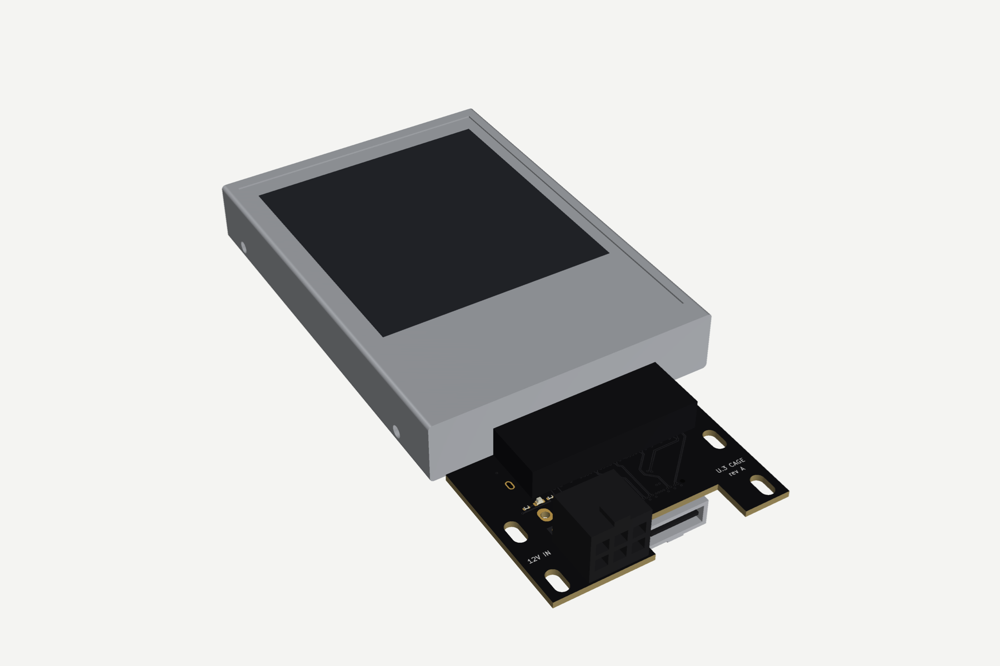

# tools/render: 3D renders of the KiCad boards

Turns any `.kicad_pcb` into photo-style 3D renders, optionally with 2.5" drives plugged into
every right-angle U.3 receptacle. Works headless (CI or a cloud box), no KiCad GUI needed.



## How it works

| Step | File | What it does |
| --- | --- | --- |
| 1 | `dump_board.py` | Runs under KiCad's own Python (`/usr/bin/python3` + `pcbnew`, KiCad 7). Exports the board outline, copper / mask / silk polygons (`ConvertBrdLayerToPolygonalContours`), drill holes and every footprint's placement and 3D-model references to JSON. |
| 2 | `pcb3d.py` | Rasterises the layers into top/bottom textures (ENIG copper where the mask is open, raised-looking copper under the mask, white silk, dark drill holes), extrudes the real outline with slots/holes cut, and places part models with KiCad's own transform chain (position → rotation → back-side flip → model offset/rotation/scale). |
| 3 | `stepmesh.py` | Loads STEP models with their colours through OpenCascade XCAF (`OCP`) and tessellates them; cached in `.cache/`. |
| 4 | `procedural.py` | Simplified models for parts with no KiCad STEP (Amphenol SFF-8639 U.3 receptacle, Amphenol OCuLink 4i, Molex Mini-Fit Jr PCIe 6-pin, 1812 fuse) and the 2.5" 15 mm drive. Appearance models from the footprint Fab outlines and datasheets, good to ~0.5 mm; not for mechanical sign-off. |
| 5 | `render.py` | pyvista/VTK off-screen renderer, standard views: `iso_top`, `iso_top_back`, `iso_bottom`, `top`, `bottom`, and with `--drives` the same iso views with drives plugged in. |

`models3d/` holds the handful of KiCad library STEP files the boards use (from
[kicad-packages3D](https://gitlab.com/kicad/libraries/kicad-packages3D), CC-BY-SA 4.0 with the
KiCad library exception), so the renders don't need the 6 GB 3D library installed. If
`/usr/share/kicad/3dmodels` exists it is searched too.

## Run it

```sh
# Ubuntu 24.04: apt install kicad xvfb ; pip install pyvista cadquery trimesh shapely mapbox_earcut pillow
xvfb-run -a python3 tools/render/render.py designs/x16-u3-card/boards/cage/u3_cage.kicad_pcb \
    docs/img/x16-u3-card --prefix cage --drives
```

Options: `--theme black|green|blue` (solder-mask colour), `--prefix` (file name prefix).
From Python, `pcb3d.Board(pcb3d.dump(path)).scene(drives=True)` returns mesh items you can drop
into a larger assembly scene (cage, shroud, case).

## Re-rendering

Renders are regenerated whenever a board changes; they are committed under `docs/img/<design>/`
so the READMEs show the current revision. To add a part that has no STEP model, add a builder to
`procedural.REGISTRY` keyed by the footprint name.
